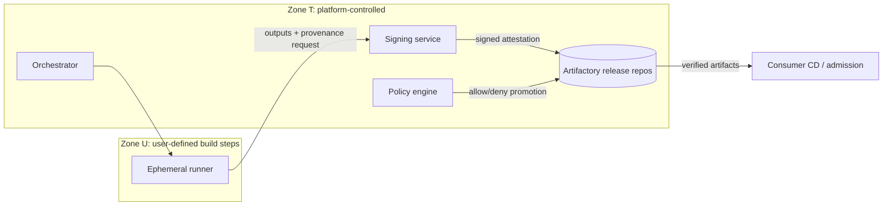
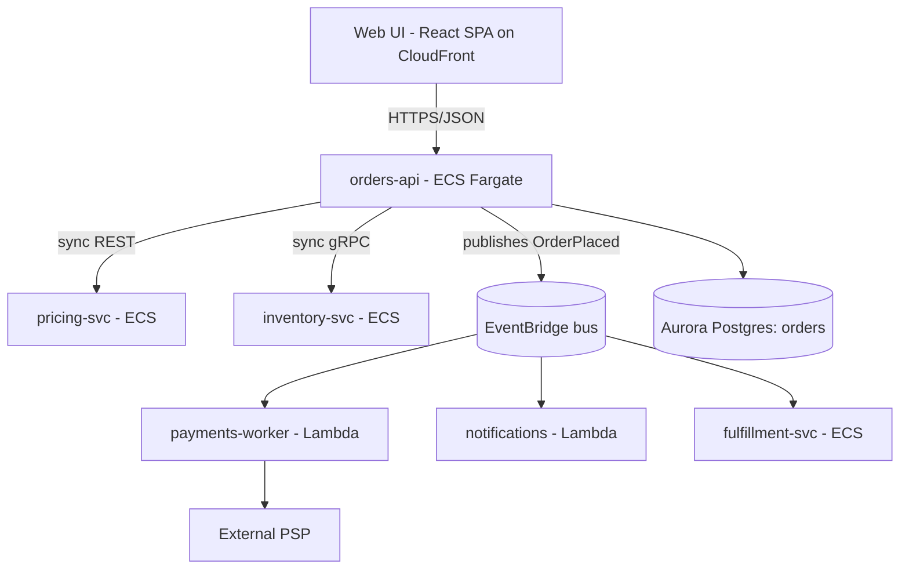

# Architecture Documentation Standards for a Multi-Team Enterprise: When, Why, Where, What, How — and What Changes When AI Agents Read It

Require one short, stable, in-repo architecture.md for each deployable system. Also require ADRs for significant decisions and one system-level doc set, built on a shared model, for each product or platform. Make humans and AI agents read the same canonical docs, with thin agent-context files acting only as routers. Do not mandate long templates for every team. The evidence says long or generated docs cost more and help less.

## TL;DR

- **Write less, closer to the code, and make it stable.** A good architecture.md is a map, not an atlas. It covers the problem, a codemap, boundaries, invariants (including "what must never happen"), and cross-cutting concerns. It lives in the repo and is revisited on triggers and roughly twice a year, not synced line by line with code. Decisions go into immutable ADRs. Volatile detail (instance counts, schemas, API specs, runbook steps) is generated or linked, never hand-copied.
- **In multi-repo estates, split ownership by C4 level.** The system-level doc owns context and container views and the cross-repo contracts. Each repo owns its own component-level map and its invariants. Neither restates the other: they reference shared IDs from one model, such as a Structurizr system catalog or a Backstage catalog, so drift becomes a detectable CI failure rather than a silent contradiction.
- **Treat AI agents as a new reader, not a new doc type.** Keep AGENTS.md/CLAUDE.md to about 100–200 lines covering commands, non-obvious conventions, do-not-touch zones and pointers into the docs. Do not paste architecture overviews into them. Controlled 2026 studies find that context files often don't improve task success and can raise cost by more than 20%, and that LLM-generated ones do worse than human-written ones. Measure before you mandate.

---

## 1. Executive summary: ten opinionated recommendations

1. **One architecture.md per deployable system, about 150–500 lines.** matklad: "keep it short: every recurring contributor will have to read it… the shorter it is, the less likely it will be invalidated." [Established]
2. **Document the absences.** Make "Architecture Invariants" and "Boundaries" mandatory sections. Invariants are often "expressed as an absence of something, and it's pretty hard to divine that from reading the code" (matklad). [Established; agent value is Synthesis]
3. **ADRs are mandatory for architecturally significant decisions. Design docs are optional and tied to ambiguity.** ADRs are short, numbered and superseded rather than edited (Nygard, 2011). Google's guidance: if a design doc is just an "implementation manual" with no trade-offs, skip it. [Established]
4. **Docs live in the repo of the thing they describe and are rendered centrally** through a portal (Backstage TechDocs, MkDocs). Wikis are for non-versioned, cross-org content. [Established for engineering docs; contested, see §6]
5. **Use C4 levels 1–2 for system docs, level 3 only where it pays, and level 4 never by hand.** [Established]
6. **One model, many views, for multi-repo systems.** Element identities come from a single catalog. Repo docs extend it and never redefine it. [Established tooling; enterprise rollout evidence is anecdotal]
7. **Freshness metadata and an owner on every architecture page, enforced in CI**, plus doc-change prompts on PRs that touch boundary-defining files. [Established]
8. **Never hand-copy volatile or derivable facts.** Generate or link schemas, specs, dependency lists, deployment counts and IAM policies. [Established]
9. **Agent-context files are routers, not encyclopedias. They are human-written and tested**, and linted for the known "configuration smells". [Emerging; mixed 2025–2026 evidence]
10. **Measure usage and correctness, not existence.** "File exists" mandates produce theater. DORA links documentation *quality*, not quantity, to performance. [Synthesis]

---

## 2. Decision framework: situation → what, where, depth

| Situation / trigger | What to produce | Where | Depth | Owner |
|---|---|---|---|---|
| Small repo (<~2k LOC), single obvious purpose | README "How it fits" section; no architecture.md | README.md | 5–15 lines | Repo team |
| Repo passes ~10k LOC, >1 team contributes, or onboarding >1 week | architecture.md | `/ARCHITECTURE.md` or `/docs/architecture.md` | 150–500 lines; C4 L1+L2 (L3 only if non-obvious) | Repo tech lead (CODEOWNERS) |
| Ambiguous design, real alternatives, cross-team impact | Design doc (context, goals/non-goals, design, alternatives, cross-cutting) | PR-reviewed Markdown, or collaborative doc archived to repo on approval | 1–3 pages ("mini") to 10–20 pages | Author(s) |
| Decision costly to reverse (datastore, protocol, runtime, trust boundary, tenancy) | ADR | `/docs/adr/NNNN-title.md` in the constrained repo; system-wide in system repo | 1–2 pages | Decider |
| New externally consumed contract | Spec (OpenAPI/AsyncAPI/protobuf) + ≤10 lines in architecture.md (owner, versioning, consumers) | Producer repo; registered in catalog | Spec as code | Producer team |
| Multi-repo product/platform (≥3 deployables) | System-level doc: landscape, containers, contract index, flows, trust boundaries, system ADRs | System repo rendered in portal; Structurizr DSL or catalog model | 5–15 pages, generated diagrams | Named system architect |
| Compliance/audit need | Control-mapping: trust boundaries, data classification, enforcement points, evidence links | Security section of system doc | Tables; link evidence | Security architect + owner |
| Incident revealed an architectural misunderstanding | Update the violated invariant/boundary; ADR if decision changes | architecture.md / ADR | Smallest preventive diff | Incident owner |
| AI coding agents used in repo | AGENTS.md router (+ tool shims) | Root + nested per package | ~100–200 lines max | Repo team |
| Prototype/spike changing weekly | **Nothing beyond README + decision-log bullets** | README | Minimal | — |
| Facts derivable from code/infra | **Don't write; generate or link** | `docs/generated/` | Automated | CI |

---

## 3. Gaps and challenges to the premise

- **"Architecture docs" are three different artifacts, and standards that conflate them fail.** *Descriptive maps* (architecture.md, C4 views) are living and short. *Decision records* (ADRs) are immutable history. *Proposals* (design docs/RFCs) are point-in-time and mostly stale after implementation. Set separate rules for each.
- **At hundreds of teams, the bottleneck is the catalog, not the template.** "Which system is this, who owns it, what does it depend on" is best answered by machine-readable ownership (e.g., Backstage `catalog-info.yaml`). Prose should hang off catalog entities.
- **Assuming AI agents need *more* documentation is, on current evidence, probably wrong.** The strongest 2026 controlled study found repository overviews in context files "are not helpful" and costs up over 20%. Agents need less but sharper context.
- **Runbooks, threat models and data-classification docs are separate artifacts.** Architecture docs should link to them, not absorb them. Absorbing them is the main cause of bloat.
- **Uniform depth is a mistake.** Tier documentation burden by risk and fan-in, not by org chart.
- **"Source of truth" is a per-fact decision**: code for structure, specs for contracts, catalog for ownership, ADRs for rationale, IaC for topology. The doc points to these and states what no machine artifact can: intent, invariants and trade-offs.

---

## 4. WHEN to create architecture docs (Q1)

### Triggers [Established + Synthesis]

| Trigger | Why | Minimum response |
|---|---|---|
| Repo passes ~10k LOC or a second team contributes | matklad targets 10k–200k LOC. Newcomers take "2x more time to write a patch" but "10x more time to figure out *where*" to change code | architecture.md with codemap |
| New service/deployable | New container; consumers need contract + owner | Catalog entry + stub + spec |
| New system or trust boundary | Boundaries "constrain all *possible* implementations" but are hard to find from code | Boundaries section + ADR |
| Architecturally significant decision | Lost rationale lets later decisions "defeat the earlier decisions" (Nygard) | ADR |
| Onboarding pain | Direct evidence that the mental map is missing | Codemap + "where to start" |
| Compliance/audit | Auditors need boundaries, controls, evidence | Controls section |
| Recurring incidents or agent mistakes rooted in misunderstanding | Invariant was implicit | Write the invariant (and an AGENTS.md one-liner) |

### When NOT to write [Established]

- **Too early:** Google notes design-doc overhead "may not be compatible with prototyping and rapid iteration", but agility is "not an excuse" to ignore known problems.
- **Too volatile:** C4's FAQ says component diagrams "may change frequently" and code diagrams "potentially become outdated very quickly". Document only the invariants you are sure of.
- **Trivially derivable:** class lists, endpoints, dependency graphs, env vars. Anthropic gives agents the same rule: exclude "anything Claude can figure out by reading code".
- **No ambiguity:** no design doc. Any ADR is three sentences.

---

## 5. WHY: problems solved, by reader (Q2)

| Reader | What they need | Theater to avoid |
|---|---|---|
| New engineers | Codemap, entry points, invariants, glossary | Org history; aspirational architecture presented as current |
| Cross-team consumers | Contract index, versioning policy, SLOs, owner, sync/async semantics | Internal component detail |
| Security/compliance | Trust boundaries, data classification, enforcement points, evidence links | Copy-pasted policy text, config screenshots |
| Incident responders | Dependency direction, failure modes, degradation, runbook links | Runbook steps embedded in prose |
| Architects/leadership | Context/container views, ADR index, risks | 40-page arc42 full of "N/A" |
| AI coding agents | Commands, non-default conventions, do-not-touch paths, pointers | Repository overviews; rules a linter already enforces |

**Evidence of value.** DORA's "Documentation quality" capability page says DORA "has found a clear link between documentation quality and organizational performance", which it defines as "the organization's ability to meet their performance and profitability goals." Google Cloud's announcement of the 2023 Accelerate State of DevOps Report puts numbers on it: "SRE practices are estimated to have 1.4x more impact on organizational performance when high-quality documentation is in place," and "high-quality documentation leads to 25% higher team performance relative to low-quality documentation." The 2021 report called documentation "foundational". DORA measures quality (eight metrics such as clarity, findability and reliability), not volume. [Established, correlational survey research]

**Theater test [Synthesis].** Verify three random claims in the doc against the system. If any is wrong and nobody has filed an issue, the doc has no readers.

---

## 6. WHERE should docs live? (Q3)

| Option | Discoverability | Versioned with code | Ownership | Drift risk | Best for |
|---|---|---|---|---|---|
| In-repo (`ARCHITECTURE.md`, `/docs`, `/docs/adr`) | Low alone; high via portal | Yes | High (CODEOWNERS) | Lowest | Repo architecture, ADRs, agent context |
| Dedicated architecture repo | Medium | Not with described code | Needs named owner | High for repo facts; OK for system views | System views, system ADRs, shared model |
| Wiki (Confluence/Notion) | High for non-engineers | No | Low (orphan pages) | Highest | Org narrative, onboarding hubs, early drafting |
| Docs-as-code portal (TechDocs, MkDocs, Docusaurus) | High | Yes (source in repos) | Inherits repo owner | Low | Default publishing layer |
| Hybrid: repo source + portal + wiki front door | High | Yes | High | Low if wiki only links | Most enterprises |

**Evidence for docs-as-code.** Spotify's TechDocs has "5000+ documentation sites and around 10000 average daily hits". Spotify was deliberately opinionated, declaring TechDocs "the one way to produce documentation". Google's g3doc puts docs beside source, which "establishes de facto ownership" and lets engineers "update the code and its associated documentation in the same change". [Established]

**The competing position.** Google writes most design docs in Google Docs for collaboration, and Spotify found its Golden Path tutorials "the most challenging to manage within a docs-like-code environment". Wikis win for many-commenter proposals, audiences without repo access, and cross-repo narrative. **Rule [Synthesis]:** draft anywhere. Approved artifacts and living architecture descriptions live in Git, and wiki pages link to them rather than forking them.

---

## 7. WHAT level of detail (Q4)

| Framework | Adopt | Skip / adapt | Why |
|---|---|---|---|
| **C4** | L1 Context, L2 Container; deployment and dynamic views for runtime-heavy systems | L3 only for complex containers, ideally generated; L4 never by hand | C4 on component diagrams: "Recommended? No, only create… if you feel they add value, and consider automating their creation" |
| **arc42** | As a checklist: Context (3), Solution Strategy (4), shallow Building Blocks (5), Deployment (7), Crosscutting Concepts (8), Decisions (9 → ADRs), Risks (11), Glossary (12) | Full 12 sections per repo; Quality (10) except tier-1; Runtime (6) except non-obvious flows | arc42 FAQ: prefer crosscutting concepts "over detailed building blocks (section 5) or runtime scenarios (section 6)" |
| **ADRs (Nygard/MADR)** | Title/Status/Context/Decision/Consequences; MADR options for contested decisions | Editing accepted ADRs; ADRs for reversible choices | Nygard: keep superseded ADRs; numbers "will not be reused" |
| **Google design docs** | Context, goals *and non-goals*, alternatives, cross-cutting concerns | Docs without ambiguity; pasted API/schema definitions | Those "quickly get out of date" |
| **Diátaxis** | Use it to *exclude*: architecture.md is explanation plus a reference-style codemap | Tutorials/how-tos/runbooks inside architecture docs | Mixing modes causes bloat |

### Anti-content: what does NOT belong in architecture.md

- Copies of API specs, protobufs, GraphQL schemas or DDL. Link to them instead.
- Runbook steps, on-call procedures, rollback commands.
- Volatile numbers: instance counts, task sizes, autoscaling thresholds, account IDs, IPs, dependency versions.
- File-by-file inventories: "a map of a country, not an atlas of maps of its states" (matklad).
- Hyperlinks to specific files. Name the module and let readers search; matklad: "Do *not* directly link them".
- Lint and style rules enforced by tooling.
- Target state without a "Target (not yet true)" label.
- People as owners. Use team handles or catalog groups.

---

## 8. HOW to maintain and review (Q5)

The core mechanisms are CODEOWNERS on architecture files, PR-triggered update prompts, freshness metadata checked in CI, triggered plus semiannual review, diagram-as-code, and usage metrics. The concrete checklist is in §12. Two positions frame it:

- **Google:** freshness blocks with owner and reviewed date, which trigger reminders (e.g., after three months untouched). "Last reviewed by…" bylines "led to increased adoption".
- **matklad:** "Don't try to keep it synchronized with code. Instead, revisit it a couple of times a year."

These are compatible. Keep the map stable and review it on triggers and on a calendar. Put fast-changing facts in generated artifacts.

**Diagram tooling.** Use Mermaid for repo-level diagrams, since it renders natively in GitHub/GitLab and in portals. Use Structurizr DSL when you need one model with many views across repos, and PlantUML where it is already entrenched. Visual tools (draw.io, IcePanel, Miro) are fine for workshops, but the canonical diagram must be regenerated from committed source.

---

## 9. Topology A: single repository

**architecture.md contents (150–500 lines; ≤15 minutes to read):**

1. **Purpose & context** (5–10 lines, C4 L1 crop, catalog link).
2. **Codemap**, which is the bulk of the doc and answers "Where is X?" and "What is this?".
3. **Entry points**: binaries, handlers, consumers, jobs.
4. **Boundaries & dependencies**: callers, callees, sync/async, owned vs consumed contracts.
5. **Architecture invariants**: bolded, testable statements.
6. **Cross-cutting concerns**: authn/z, errors, observability, config, testing.
7. **Decisions**: link to the ADR index.
8. **Known gaps/debt.**

**Relationship to other files:**

- README covers *what it is and how to run it*.
- architecture.md covers *how it is shaped and where to change things*.
- ADRs cover *why it is this way*.
- API specs cover *the exact contract* and are generated.
- AGENTS.md covers *what an agent must do and avoid*, and points to the rest.

**Real-world reference: rust-analyzer's architecture.md** (matklad's model example). At a pinned commit it is 518 lines (~27 KB): Bird's Eye View, Entry Points, a Code Map of roughly 20 crate subsections, and Cross-Cutting Concerns, with bold "**Architecture Invariant:**" and "**API Boundary**" labels. **Critique:** it has an excellent codemap and invariants. It is also longer than most enterprise services need, has a "Performance Testing: TBA" stub, admits a "code--architecture gap", has no ADRs and little security content, and has since moved to a new path, a reminder that links into docs rot too. **Lesson:** copy its invariant style, not its length.

**Contrast: Backstage's "Architecture overview".** It is a well-diagrammed tour of frontend, backend, plugins and databases ("separate logical database per plugin"), but it mixes concepts with how-to material, uses time-relative wording ("at this time of writing"), and keeps the threat model on a separate page. Linking the threat model is correct. The time-relative wording is a drift smell.

---

## 10. Topology B: multi-repository / multi-application

### What goes where

| Content | System-level doc | Repo-level architecture.md |
|---|---|---|
| C4 L1 context/landscape | **Owns** | Links; may show generated crop |
| C4 L2 containers | **Owns** | Own container + direct neighbors, generated |
| C4 L3 components | Never | **Owns** (if needed) |
| Contract index | **Owns** the index | Owns specs it produces; lists consumed contracts by ID |
| Cross-repo flows | **Owns** 2–5 critical flows | References flow IDs |
| Trust boundaries, data classification | **Owns** system view | States local enforcement points |
| Ownership | Rendered from catalog | `catalog-info.yaml` in repo |
| Shared libraries | Lists with owner and support policy | Declares usage and constraints |
| ADRs | System-wide (protocols, tenancy, identity) | Local |

### Preventing duplication and contradiction

- **One model, referenced by ID.** Structurizr recommends one workspace per software system plus a landscape-scoped workspace. Its enterprise pattern defines people and systems once in a shared **system catalog**, has each team's workspace `extends` it, and runs `generate system-landscape` to aggregate a central view. [Established tooling]
- **Alternative: the service catalog as model.** Backstage entities (Component, API, System, Domain, Resource) with `providesApis`/`consumesApis` relations require less modeling effort but give weaker diagrams.
- **Detect drift from runtime.** The C4 FAQ suggests building context views from "existing system/service catalogs" and container views by "parsing log files or using OpenTelemetry data". Use traces to *detect* undeclared edges, not to replace declared intent.
- **Rule [Synthesis]:** neither level describes another repo's internals. Each refers to the other by catalog ID.

### Shared libraries, runtimes, contracts

- **Shared libraries** are catalog components with an owner, a semver and support policy (N and N-1), a deprecation window, and a *scope limit* ("cross-cutting plumbing only; no domain logic"). The classic failure is a "commons" library that becomes a distributed monolith.
- **Multiple runtimes:** a deployment view per environment *class*, with runtime constraints written as invariants (cold starts, timeouts, statelessness, egress).
- **Contracts:** specs live in the producer repo and are published to a registry. The index records owner, consumers, sync/async, delivery semantics and compatibility policy.

### Source of truth

| Fact | Source of truth | Doc behavior |
|---|---|---|
| Repo structure | Code | Stable shape only |
| Contracts | Producer spec files | Link; CI breaking-change check |
| Ownership | Catalog | Render |
| Topology | IaC | Generate/review against IaC |
| Cross-system relations | Shared model | Generate; compare declared vs observed |
| Rationale | ADRs | Supersede, don't edit |

---

## 11. Worked examples: GOOD vs BAD

### Example 1 — CI/CD platform (orchestration + Artifactory + security tooling)

**Framing.** The platform is a product for internal teams, so separate the *consumer contract* from *internals*. Use supply-chain standards as the trust vocabulary:

- **SLSA Build levels.** L1: "Provenance showing how the package was built". L2: "Signed provenance, generated by a hosted build platform". L3: "Hardened build platform", which must "prevent runs from influencing one another" and keep signing secrets out of user-defined steps.
- **Sigstore keyless signing** "associates identities, rather than keys, with an artifact signature" using short-lived Fulcio certificates and the Rekor transparency log.
- **SBOM minimum elements.** NTIA's 2021 list has seven fields: "Supplier, Component Name, Version of the Component, Other Unique Identifiers, Dependency Relationship, Author of SBOM Data, and Timestamp". CISA's July 29, 2026 press release for the "2026 Minimum Elements for a Software Bill of Materials (SBOM)" says "There are several new minimum elements, such as Component Hash Algorithm, Component License, SBOM Tool Name, and SBOM Generation Context." The update also renames Supplier Name to Component Producer, Version of the Component to Component Version, and Author of SBOM Data to SBOM Author.

**(a) GOOD doc set**

```
platform-cicd/
  ARCHITECTURE.md            # internals, ~400 lines
  docs/consumer-guide.md     # the product contract
  docs/policy-gates.md       # GENERATED from policy-as-code repo
  docs/adr/0007-keyless-signing-sigstore.md
  docs/adr/0011-artifactory-as-sole-promotion-path.md
  AGENTS.md                  # ~80 lines, router
```

```markdown
# CI/CD Platform — Architecture
owner: team:platform-delivery · last_reviewed: 2026-09-14 · review_interval: 90d

## Purpose
Build, verify, sign and promote artifacts for product teams. Target: SLSA Build L3
for tier-1 services, L2 otherwise (ADR-0004). Gap to target is tracked under Known gaps.

## Pipeline stages and enforcement points
| Stage | Runs where | Enforcement point (blocking?) | Evidence emitted |
|---|---|---|---|
| Source | SCM | Branch protection, signed commits (blocking, tier-1) | SCM audit log |
| Build | Ephemeral isolated runners | Deps only via Artifactory remotes (blocking) | SLSA provenance |
| Scan | Same run | SAST, SCA, secrets; thresholds live in policy repo | Reports attached to build |
| Sign | Signing service (separate trust zone) | Keyless; runner never holds keys | Signature + Rekor entry |
| SBOM | Same run | Required for promotion (blocking) | SPDX/CycloneDX in Artifactory |
| Promote | Artifactory | Only if provenance+signature+SBOM verify (blocking) | Promotion record |
| Deploy | Consumer CD | Admission controller verifies signature (prod) | Admission log |

## Trust boundaries


## Architecture invariants
- **No artifact reaches a release repo without verified provenance, signature and SBOM.** Break-glass is ADR-0013 and audited.
- **User-defined build steps never see signing material.**
- **Runners have no direct internet egress;** all dependencies resolve through Artifactory.
- Policy thresholds live in `policy-as-code`; this doc never restates them.

## How consuming teams interact
See docs/consumer-guide.md: required template version, what blocks you, exception process,
SLOs (queue time p95, availability), support channel.
```

**(b) BAD**

```markdown
# CI/CD Architecture (Confluence, last edited 2023)
We use Jenkins with 42 agents (m5.2xlarge) and Artifactory 7.41 on 3 nodes.
Steps: 1) checkout 2) mvn clean install 3) run Fortify 4) run Snyk with
--severity-threshold=high 5) if fails, ping #security ... [300 lines of Jenkinsfile pasted]
Security is handled by the security team. See also: (link to 404).
```

**What's wrong:**

- Volatile facts: agent counts, versions, instance types.
- Pasted pipeline code that duplicates the template repo.
- Policy thresholds hard-coded in prose, which will contradict the policy engine.
- No trust boundaries or enforcement points.
- "Security is handled by…" dodges ownership.
- No consumer contract.
- An ownerless wiki page with no freshness date.

**(c) Judgment calls:**

- Split the consumer guide (many readers, stable) from internals (few readers).
- Generate the policy-gate table.
- Present enforcement points as a table, because that is what auditors and incident responders scan.
- State target SLSA levels per tier and record the gap as debt, not as a claim.

---

### Example 2 — Web app: UI + primary backend + 5 services, shared libs, ECS + Lambda

**(a) GOOD system-level doc (`orders-system-architecture` repo)**

```markdown
# Orders System — System Architecture
owner: group:orders-arch · last_reviewed: 2026-08-30 · model: ./workspace.dsl

## Containers (C4 L2) — generated from model


## Communication rules
- Sync only on the request path for data needed to answer the user; everything after
  order acceptance is async via EventBridge.
- Events are at-least-once; consumers are idempotent on `orderId` + `eventId`.
- **No service reads another service's database** (enforced by IAM).

## Contract index
| Contract | Type | Producer | Consumers | Compatibility |
|---|---|---|---|---|
| orders-api v2 | OpenAPI | orders-api | UI | additive only; v1 sunset ADR-0021 |
| OrderPlaced v3 | JSON Schema (registry) | orders-api | payments, notifications, fulfillment | backward-compatible; CI check |
| inventory.Reserve | protobuf | inventory-svc | orders-api | buf breaking check |

## Shared libraries
| Library | Owner | Scope | Versioning |
|---|---|---|---|
| @orders/auth-client | team:identity | token validation only | semver; N and N-1 |
| orders-events (TS + Python) | team:orders-core | generated event types; no logic | per schema version |
Rule: no domain logic in shared libs without an ADR.

## Runtime-specific constraints
| Concern | ECS services | Lambda functions |
|---|---|---|
| State | stateless tasks; sessions in Redis | stateless; no reliance on warm containers |
| Timeouts | ALB idle timeout governs | function timeout < queue visibility timeout |
| Concurrency | autoscaling (values in IaC) | reserved concurrency in IaC for PSP limits |
| Deploy | blue/green | aliases + weighted traffic |

## Key flows: F1 Place order · F2 Payment failure & compensation
## System ADRs: 0003 EventBridge fan-out · 0009 no shared DB · 0021 API v1 sunset
```

Each service repo (e.g., `payments-worker`) has a purpose statement, a generated neighbor-only L2 crop, a codemap, **invariants** ("Never calls PSP without idempotency key"; "Never writes to orders DB"), consumed contracts by ID, and local ADRs.

**(b) BAD:** a 60-page "Solution Architecture Document" in the primary backend repo. It describes all five services' classes, lists ECS task counts and Lambda memory sizes, copies the OpenAPI spec as a table, and has a hand-drawn diagram still showing payments as an ECS service. The shared library section says "use the commons lib" with no owner. The `fulfillment-svc` README contradicts it about sync vs async.

**What's wrong:**

- System facts live in one service's repo.
- It duplicates specs and IaC.
- It describes other teams' internals, which guarantees drift.
- There are no delivery semantics.
- Shared code has no owner.
- The diagram is not model-generated, so the runtime change never propagated.

**(c) Judgment calls:**

- Write sync vs async as a *rule*, not a description.
- Use one runtime-comparison table and keep the numbers in IaC.
- The shared-library scope limit is the most valuable sentence in the doc.
- Per-service docs show neighbors only.

---

### Example 3 — Event-driven data/ML pipeline (stress test: "the code is not the architecture")

**GOOD (excerpt):**

```markdown
## Data flow (logical)
raw events (Kafka) → bronze (Iceberg) → silver (dedup, PII-tokenized) → gold features → feature store → training / online serving
## Invariants
- PII never leaves tokenization in clear text; silver and downstream are tokenized.
- Training and serving read the same feature definitions (no skew by construction).
- Backfills are idempotent per partition date.
## Data contracts: producer-owned schemas in registry; IDs + freshness SLOs only here.
## Elsewhere: DAG code, generated lineage, per-model cards.
```

**BAD:** a table of every Airflow task with schedules and retries, DAG UI screenshots, and copied warehouse column lists.

**Where the guidance breaks down:** a codemap matters less than a *dataset/lineage map*, which is best generated from a data catalog. Keep human-authored invariants (PII, skew, idempotency) as the core.

### Example 4 — Public library/SDK (stress test: the API *is* the architecture)

**GOOD:** a short contributor-facing architecture.md with layering and compatibility invariants ("public API changes require a two-minor-version deprecation cycle"; "core has zero runtime dependencies"; "no HTTP client imported outside `transport/`"). Separately, Diátaxis-structured user docs with a generated API reference.

**BAD:** an architecture.md that is really a user guide, mixing install steps, API tables and internal design so that it serves neither users nor contributors.

**Where it breaks down:** C4 context and container views add almost nothing here, so skip them. The architecture doc shrinks to module layering and compatibility rules.

### Example 5 — Large polyglot monorepo (stress test: one repo, many systems)

**GOOD:**

- A root `ARCHITECTURE.md` of ≤200 lines covering package taxonomy (apps/, services/, libs/, tools/), dependency-direction rules ("libs never depend on apps") enforced by the build graph (Bazel visibility, Nx module boundaries), and directory ownership via CODEOWNERS.
- A short architecture.md for each package with real internals.
- Nested AGENTS.md files for package-specific commands. Claude Code reads CLAUDE.md files recursively, and Copilot supports nested/path-scoped instructions.

**BAD:** a 3,000-line root doc covering every package, or 400 package READMEs with no dependency rules.

**Where it breaks down:** "one architecture.md per deployable" maps to packages, not repos. The system doc lives at `/architecture/`. Dependency rules belong in the build graph, with prose explaining *why*.

---

## 12. Maintenance and review playbook

### Rollout checklist

- [ ] **Tiering:**
  - T1 (revenue/regulated/high fan-in): architecture.md + ADRs + system-doc participation + quarterly review.
  - T2: architecture.md + ADRs.
  - T3: README "How it fits" + catalog entry.
- [ ] **Catalog entry** per deployable: owner group, system, lifecycle, provided/consumed APIs, TechDocs annotation.
- [ ] **CODEOWNERS** on `ARCHITECTURE.md`, `docs/adr/**`, `AGENTS.md`, `CLAUDE.md`, `.github/copilot-instructions.md`, `.github/instructions/**`.
- [ ] **Front matter** on every architecture page: `owner`, `last_reviewed`, `review_interval`, `status` (current/target/deprecated).
- [ ] **ADR tooling:** template, monotonic numbering, auto-generated index, lint that every superseded ADR links to its successor.
- [ ] **Diagram-as-code** rendered in CI.
- [ ] **Portal** publishing with a "report issue" button on every page (TechDocs ships a ReportIssue add-on).

### CI checks (in order of value)

1. **Link and diagram-render checks** (Mermaid/Structurizr/PlantUML compile).
2. **Freshness:** warn when `last_reviewed + review_interval` has passed; block only if the owner is missing.
3. **Boundary-change prompt:** PRs touching contracts, IaC networking/IAM, new top-level directories, new topics/queues or new external dependencies get a checklist comment ("architecture.md? ADR? contract index?"). T1 requires an explicit "no doc change needed" checkbox.
4. **Contract checks:** breaking-change detection (e.g., `buf breaking`). Contract-index entries must resolve to real specs.
5. **Model consistency:** every model container maps to a catalog entity and every `consumesApis` relation appears in the model. Optionally compare with the OpenTelemetry service graph and report undeclared edges.
6. **Docs lint** (Vale/markdownlint): required headings, plus forbidden volatile patterns in architecture.md (instance types, raw IPs, account IDs, "currently N replicas").
7. **Agent-context lint:** line budget, no duplicated linter rules, no unexplained URLs, no conflicting directives (§13).

### PR and review process

- Doc changes ride in the same PR as the code (the g3doc lesson).
- architecture.md changes are reviewed by the repo CODEOWNER. Contract or system-invariant changes also need a system-doc owner.
- ADRs: opened as a PR with status `Proposed`, merged as `Accepted`. A reversal is a new ADR plus a status change on the old one.
- Design reviews are async by default. Synchronous review is only for T1 cross-team changes; Google warns reviews "are also a dangerous trap of overhead".
- **Semiannual audit** per T1/T2 repo: the owner verifies five random claims, prunes, and updates `last_reviewed`. AI pre-passes are allowed, but a human signs off.

### Usage metrics (quarterly)

| Metric | Signal | Direction |
|---|---|---|
| Portal views / unique readers per entity | Is anyone reading? | Investigate zeros for T1/T2 |
| "Doc incorrect" reports and time-to-fix | Correctness, responsiveness | Fix time down |
| Stale ratio | Maintenance health | <10% for T1 |
| Onboarding time-to-first-merged-PR | Real outcome | Down |
| Zero-result searches | Findability | Down |
| Agent rework on structural mistakes | Agent-facing value | Down |

---

## 13. AI-era addendum (standalone)

*Labels: [Evidence] = controlled or empirical study; [Vendor] = tool-maker guidance; [Emerging] = practitioner reports; [Synthesis] = this report's recommendation. Dates are given because this area moves quickly.*

### 13.1 Agent-context files (as of Oct 2026)

- **AGENTS.md** is an open Markdown convention, "a README for agents", with no required fields. It emerged from OpenAI Codex, Amp, Google Jules, Cursor and Factory, was formalized around August 2025, and has been stewarded by the Linux Foundation's Agentic AI Foundation since December 9, 2025. The site claims use by "over 60k open-source projects". [Vendor]
- **CLAUDE.md** (Claude Code) is loaded every session, with enterprise/user/project/local scopes and recursive discovery. Anthropic's best-practices page: "Keep it concise. Bloated CLAUDE.md files cause Claude to ignore your actual instructions!" It says to include "Bash commands Claude can't guess" and exclude "anything Claude can figure out by reading code". Anthropic's own memory docs ("How Claude remembers your project") set the budget: "target under 200 lines per CLAUDE.md file", because "Files over 200 lines consume more context and may reduce adherence." [Vendor]
- **GitHub Copilot** uses `.github/copilot-instructions.md`, path-scoped `.github/instructions/*.instructions.md` with `applyTo` globs (`excludeAgent` added Nov 2025), and also reads AGENTS.md and CLAUDE.md. [Vendor]
- **Recommendation:** make AGENTS.md canonical and keep tool-specific files as thin shims or symlinks. [Synthesis]

### 13.2 What the evidence says (mixed; read carefully)

| Study (date) | Design | Finding | Implication |
|---|---|---|---|
| Gloaguen et al., ETH Zurich/LogicStar, arXiv 2602.11988 (Feb 2026; revised through Sept 2026) [Evidence] | SWE-bench Lite + CTXBENCH (138 tasks, 12 repos with developer-committed files); several agents/LLMs | Context files "do not generally improve task success rates, while increasing inference cost by over 20%"; repository overviews "are not helpful". In v1, developer-provided files improved performance over none "(an increase of 4% on average), while LLM-generated context files have a small negative effect". Instructions *are* followed | Don't auto-generate; no overviews; include only what's "not already present in the README (e.g., specific conventions or non-functional requirements)" |
| Lulla et al., arXiv 2601.20404 (Jan 2026; workshop paper) [Evidence, small] | 10 repos, 124 PRs, Codex CLI only | Associated with 28.64% lower median runtime, 16.58% fewer output tokens, "comparable" completion | Efficiency gain possible; one agent, associational |
| Khatri, arXiv 2607.27250 (Jul 2026) [Evidence, small] | Claude Code + Codex, 17 tasks, 288 runs; none / always-on / selective | No measurable correctness effect (bounded <10–15pp); failures were implementation skill, not missing repo knowledge | Context files don't fix capability gaps |
| Chatlatanagulchai et al., arXiv 2511.12884 (Nov 2025) [Evidence, descriptive] | 2,303 files, 1,925 repos | Long, hard to read, maintained like config; security (14.8%) and performance (14.5%) instructions rare | NFR constraints are the real gap |
| UFMG "Configuration Smells", arXiv 2606.15828 (Jun 2026) [Evidence, descriptive] | 100 popular repos | 91/100 had ≥1 smell: lint leakage 62%, context bloat 42%, skill leakage 35%, conflicting instructions 28%, init fossilization 24%, blind references 16% | Lint for these in CI |
| OpenAI "Harness engineering" (Feb 11, 2026) [Vendor case study] | Agent-built internal product | "One big AGENTS.md" failed; switched to ~100-line AGENTS.md as "table of contents" pointing to a structured `docs/` "system of record" incl. ARCHITECTURE.md, mechanical freshness/cross-link checks, recurring "doc-gardening" agent | Progressive disclosure + mechanical enforcement |

**Bottom line [Synthesis].** The best-supported claims are negative: long, overview-heavy or generated context files don't help and cost tokens. The positive effects (efficiency, adherence to non-standard conventions) are modest and come from small studies. No study yet shows that architecture.md *itself* improves agent outcomes. That benefit is plausible for structural tasks but unproven.

### 13.3 How AGENTS.md relates to architecture.md

```
AGENTS.md  (≤ ~100–200 lines; loaded every session)
  ├─ Commands: build, single test, lint, typecheck, run
  ├─ Non-default conventions the agent would get wrong
  ├─ Do-not-touch zones + why (generated, migrations, vendored, security-critical)
  ├─ Invariants as one-liners WITH pointer to canonical section
  └─ "Read before structural changes": ARCHITECTURE.md §Boundaries, docs/adr/index.md
ARCHITECTURE.md, docs/adr/, specs, generated/  (read on demand)
```

**Rules [Synthesis, grounded in the sources above]:**

- AGENTS.md never restates the overview; it points to it (the ETH result, and OpenAI's "map" framing).
- Invariants are the one exception worth duplicating as one-liners, because they change agent *decisions*. Each carries a pointer to its canonical section so drift is checkable.
- Use nested AGENTS.md files for package-specific commands, not to arbitrarily split one big file.
- Task-specific instructions go into on-demand skill files, which addresses "skill leakage".

### 13.4 What agents need that humans can often infer

- **Exact commands.** Humans ask a colleague; agents guess.
- **Explicit negative constraints:** "never edit `gen/`", "never add a dependency to `core`".
- **Enforcement over prose.** Move constraints into import linters, build-graph visibility, architecture tests and IAM. A failing check steers an agent more reliably than a sentence, which is consistent with the "lint leakage" finding. [Synthesis]
- **Dependency direction**, stated once in a consistent place.

### 13.5 Context-window economics and progressive disclosure

Always-loaded text is paid for every session and competes with the task. OpenAI names the failure modes: crowding, guidance overload, rapid rot, unverifiability. Use three tiers:

1. An always-on router (AGENTS.md).
2. On-demand canonical docs (ARCHITECTURE.md, ADR and contract indexes).
3. Generated reference (schemas, specs).

Consistent headings across repos (`## Codemap`, `## Boundaries`, `## Architecture invariants`) make tier-2 retrieval reliable for agents and searchable for humans. A small YAML front matter (owner, last_reviewed, system ID, status) is cheap and useful. Elaborate per-section schemas are unsupported by evidence; AGENTS.md itself deliberately has "no required fields". [Emerging/Synthesis]

### 13.6 Risks of AI-generated architecture docs

- **Confident drift.** LLMs describe what they see, not intent. They cannot recover invariants expressed as absences, and they fill gaps plausibly. ETH recommends "omitting LLM-generated context files for the time being."
- **Init fossilization.** `/init`-generated files capture day-one structure and rot (24% in the UFMG sample).
- **Authority laundering.** Polished output earns unearned trust.
- **Policy [Synthesis]:** AI may draft architecture docs and ADRs. A named human verifies every structural claim and invariant before merge, and AI-drafted PRs are labeled. Agent-context files are human-authored.

### 13.7 Using AI to detect doc/code drift

Research shows promise and a false-positive problem:

- **DocPrism:** filtering cut its inconsistency flag rate from 98% to 14% and raised accuracy from 14% to 94%.
- **CASCADE (FSE):** generates tests from docs and reports an inconsistency only when existing code fails while doc-derived code passes.

Both target API- and function-level docs, not architecture prose. **Practical pattern [Emerging]:** a scheduled doc-gardening job checks ARCHITECTURE.md claims deterministically first (named modules and directories exist; declared dependencies match the import graph, catalog and traces), then uses LLM judgment. It opens suggestion PRs routed to the owner and never auto-merges.

---

## 14. Templates

### 14.1 Minimal repo-level `ARCHITECTURE.md` (annotated)

```markdown
---
owner: team:<catalog-group>          # catalog group, not a person
system: <catalog-system-id>
last_reviewed: YYYY-MM-DD
review_interval: 180d                # 90d for tier-1
status: current                      # current | target | deprecated
---
# <Service> — Architecture

## 1. Purpose and context            <!-- 5–10 lines + C4 L1 crop (generated if possible) -->
## 2. Codemap                        <!-- 40–60% of doc. Name modules/types; don't hyperlink files -->
- `cmd/server` — HTTP entry point; wires adapters.
- `domain/` — pricing rules; **no I/O**.
## 3. Entry points                   <!-- 3–10 bullets -->
## 4. Boundaries and dependencies    <!-- table: direction, counterparty, contract ID, sync/async, semantics -->
## 5. Architecture invariants        <!-- 3–10 bold, testable statements + how enforced. Highest value. -->
- **`domain/` never imports from `adapters/`.** (enforced: import-lint rule)
## 6. Cross-cutting concerns         <!-- 10–30 lines: authn/z, errors, observability, config, testing -->
## 7. Deployment (shape only)        <!-- 5–15 lines; numbers live in IaC -->
## 8. Decisions                      <!-- links to ADR index + 3–5 key ADRs -->
## 9. Known gaps and debt            <!-- ≤10 bullets; label "Target (not yet true)" -->
```

**Length budgets:** T3 ≈ 80–150 lines; T2 ≈ 150–300; T1 ≈ 300–500. Beyond 500 lines, split into linked explanation pages.

### 14.2 System-level doc template (multi-repo)

```markdown
---
owner: group:<system-architects>
system: <catalog-system-id>
model: ./workspace.dsl               # diagrams generated from here
last_reviewed: YYYY-MM-DD
review_interval: 90d
---
# <System> — System Architecture
## 1. Scope, goals, non-goals         <!-- ½ page; non-goals mandatory -->
## 2. Landscape / context (C4 L1)     <!-- generated -->
## 3. Containers (C4 L2)              <!-- generated; every box = catalog entity -->
## 4. Communication rules             <!-- sync/async policy, delivery semantics, idempotency, timeouts -->
## 5. Contract index                  <!-- ID, type, producer, consumers, compatibility, spec link -->
## 6. Key flows (2–5)                 <!-- business-critical + failure/compensation -->
## 7. Trust boundaries & data classification <!-- enforcement-point table; link evidence -->
## 8. Deployment topology (shape)     <!-- per environment class; runtime-constraint table -->
## 9. Shared libraries & platforms    <!-- owner, scope limit, support policy -->
## 10. Cross-cutting concepts         <!-- identity, observability, tenancy, resilience -->
## 11. System ADRs                    <!-- index -->
## 12. Risks & technical debt         <!-- ranked, owned -->
## 13. Glossary                       <!-- resolves naming conflicts across repos -->
<!-- NOT here: repo internals, runbooks, specs, IaC numbers -->
```

### 14.3 Minimal `AGENTS.md` (router)

```markdown
# AGENTS.md  (≤ ~150 lines; human-written; CODEOWNERS-reviewed)
## Commands
- Build: `make build` · Test: `make test` · Single test: `go test ./pkg/x -run TestY`
- Lint/typecheck: `make lint` (run `make fmt`; don't hand-format)
## Conventions an agent would get wrong
- Wrap errors with `errs.Wrap`, never `fmt.Errorf`, in `domain/`.
## Do not touch
- `gen/**` (run `make gen`) · `migrations/**` (human review) · `vendor/**`
## Constraints (canonical: ARCHITECTURE.md §5)
- `domain/` must not import `adapters/`. No new deps in `core/` without an ADR.
## Read before structural changes
- ARCHITECTURE.md §2 Codemap, §4 Boundaries · docs/adr/README.md
```

---

## 15. Open questions and areas where evidence is weak

- **Does architecture.md improve agent outcomes?** Not directly studied, and the strongest study finds overviews unhelpful. A/B test on internal tasks before mandating agent-specific architecture content. [Weak]
- **Optimal length.** "Short" is the consensus (matklad, Anthropic, OpenAI). Numbers such as 100, 200 or 500 lines are heuristics, not findings. [Folklore-adjacent]
- **ROI of component diagrams and of Structurizr-style modeling at scale.** Evidence is vendor and practitioner testimony. [Weak]
- **Wiki vs repo.** Spotify and Google show docs-as-code works, but both invested heavily in tooling and writers. [Moderate]
- **DORA causality.** The findings are survey-based and correlational. [Moderate]
- **AI drift detection for architecture prose** has no published benchmarks. [Weak]
- **Agent-context conventions change monthly.** Re-validate §13 every six months.
- **CISA 2026 SBOM fields** are confirmed by CISA's July 29, 2026 press release (Component Hash Algorithm, Component License, SBOM Tool Name, SBOM Generation Context; Supplier Name renamed Component Producer). Map policy gates to the published field names.

---

## 16. Note on sources

Sources are cited inline by author/organization, title and date:

- matklad, "ARCHITECTURE.md" (Feb 2021); rust-analyzer architecture.md; Backstage architecture overview.
- Google: Malte Ubl, "Design Docs at Google" (2020); *Software Engineering at Google*, ch. 10.
- Michael Nygard, "Documenting Architecture Decisions" (2011).
- Frameworks and tooling: the C4 model site and FAQ; arc42 and its FAQ; Diátaxis; Structurizr docs; Backstage TechDocs.
- DORA research.
- Supply chain: SLSA v1.0 levels; Sigstore docs; NTIA (2021) and CISA (2026) SBOM minimum elements.
- Agent-context sources: agents.md; the Agentic AI Foundation announcement (Dec 2025); Anthropic Claude Code docs; GitHub Copilot docs; OpenAI "Harness engineering" (Feb 2026); the arXiv studies dated in §13.
