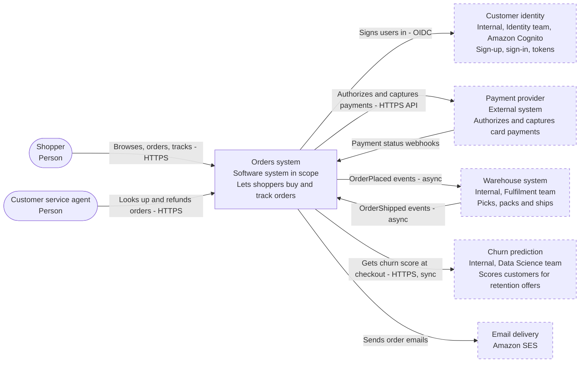
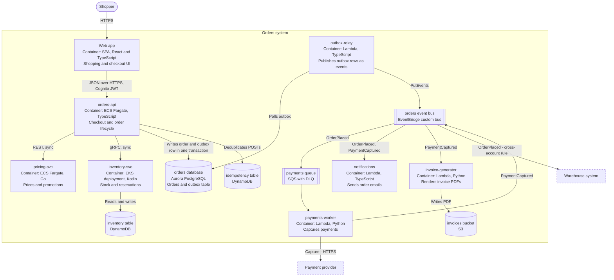
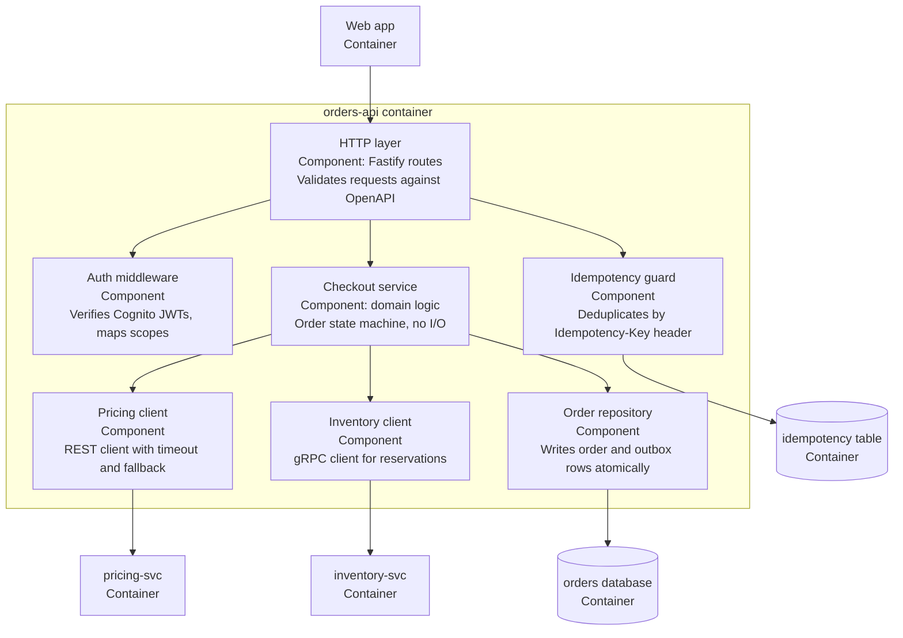
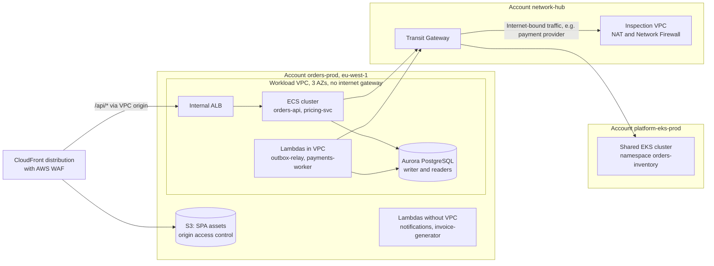
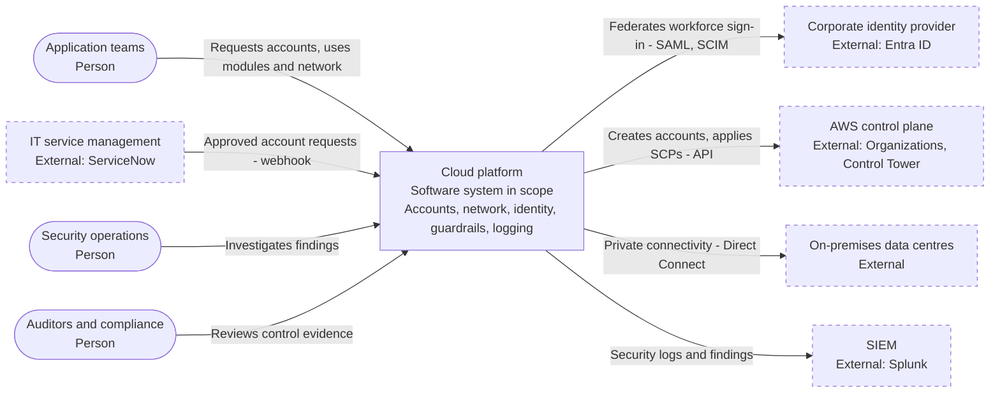
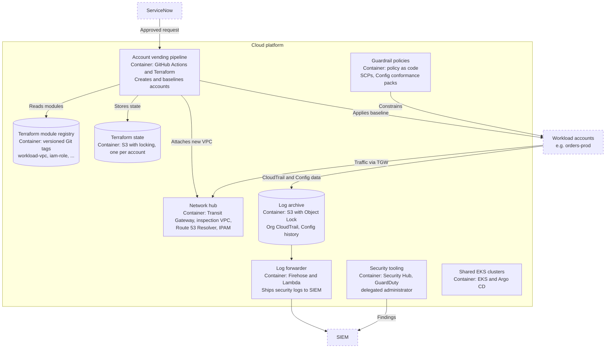
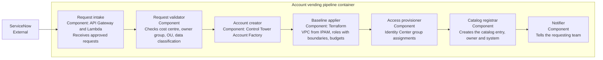
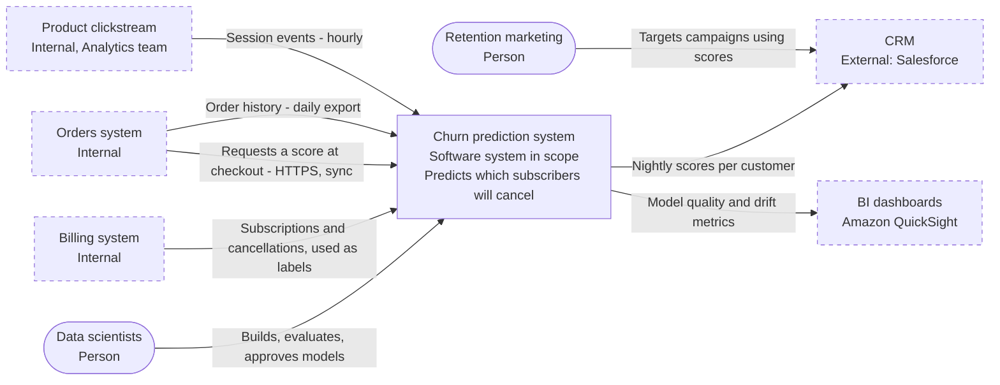
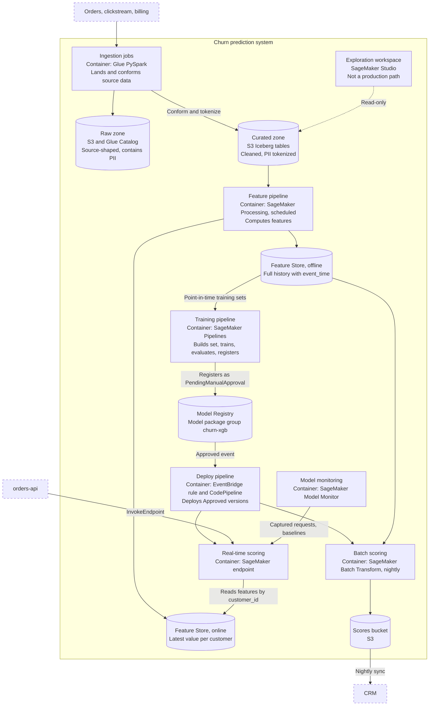
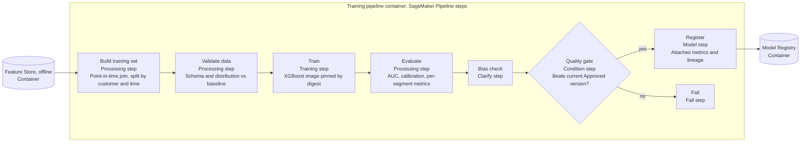

# Architecture Documentation, Made Concrete

Absences, invariants, C4 levels, non-default conventions, wiki links and anti-content, with AWS examples.

This is a companion to *Architecture Documentation Standards for a Multi-Team Enterprise* and its annotated source list, written to be read on its own. Each concept is defined here and illustrated with embedded examples. The links are for going deeper and are not required reading. Compiled October 7, 2026.

**Contents**

- §0 Three running example systems
- §1 Vocabulary at a glance
- §2 Absences
- §3 Architecture invariants
- §4 C4 diagrams: L1, L2 and L3 for all three systems
- §5 Non-default conventions
- §6 When the docs live in a central wiki
- §7 Anti-content, with the why
- §8 Putting it together: two ARCHITECTURE.md excerpts
- §9 Link notes

Statements about AWS behaviour link to AWS documentation. Statements marked *(recommendation)* are this document's own synthesis, not an established standard.

---

## 0. Three running example systems

All three systems are fictional but built from common AWS patterns. They belong to one company and depend on one another on purpose, because the hardest documentation problems sit at the seams between systems.

### Orders (UI, API, backend)

- **UI.** Shoppers use a React single-page app (SPA), served from S3 through CloudFront.
- **Core service.** The SPA calls `orders-api`, a TypeScript service on ECS Fargate that owns checkout and the order lifecycle.
- **Supporting services.** `pricing-svc` is written in Go and runs on ECS. `inventory-svc` is written in Kotlin, runs on the platform team's shared EKS cluster and keeps its data in DynamoDB.
- **Data.** Orders live in Aurora PostgreSQL.
- **After acceptance.** Once an order is accepted, the rest happens asynchronously. An outbox relay publishes domain events to an EventBridge bus, which fans out to Lambda functions for payments (through an SQS queue), notifications (via SES) and invoice PDFs (stored in S3).
- **Sign-in.** Uses a Cognito user pool owned by the separate Identity team.

### Cloud platform (infrastructure)

This is the landing zone that everything else runs in. It is all Terraform, spread across several repos.

- **Accounts and OUs.** AWS Organizations with Control Tower. Organizational units (OUs) for security, infrastructure, workloads and sandboxes.
- **Workforce sign-in.** IAM Identity Center, federated to the corporate identity provider (IdP).
- **Guardrails as code.** Service control policies (SCPs), AWS Config rules and IAM permissions boundaries.
- **Networking.** A network hub account with Transit Gateway (TGW), a central egress ("inspection") VPC with NAT gateways and AWS Network Firewall, Route 53 Resolver for hybrid DNS, and VPC IPAM for address allocation.
- **Logging.** An organisation-wide CloudTrail trail that writes to a log-archive account.
- **Shared compute.** Shared EKS clusters, deployed through Argo CD.
- **Account vending.** A Terraform-based pipeline that creates new accounts.

### Churn prediction (data analytics and ML)

This system predicts which subscribers are likely to cancel.

- **Data lake.** Data from Orders, product clickstream and billing lands in an S3 data lake with raw and curated zones, the Glue Data Catalog and Lake Formation permissions.
- **Features.** Computed on SageMaker Processing and stored in SageMaker Feature Store: the offline store for training, the online store for real-time lookups.
- **Training.** A SageMaker Pipeline trains, evaluates and registers each model in the Model Registry.
- **Deployment.** Approved models run in two places: a nightly Batch Transform job, whose scores go to the CRM, and a real-time endpoint that `orders-api` calls at checkout.
- **Monitoring.** Model Monitor watches for drift.

AWS's documentation now calls the service "Amazon SageMaker AI". This document uses "SageMaker".

---

## 1. Vocabulary at a glance

| Term | One-line definition | Orders example | Usually lives in | Enforced by |
|---|---|---|---|---|
| Boundary | Where the system ends, and who it talks to in which direction | `orders-api` calls `pricing-svc` synchronously; payments are triggered by events | ARCHITECTURE.md; C4 L1 and L2 | Network, IAM, contracts |
| Absence | A deliberate "never": something the system does not do, contain or depend on | The SPA never calls AWS services directly | ARCHITECTURE.md invariants | IAM, lint rules, architecture tests |
| Invariant | A property that must hold for every valid version of the system | Only `orders-api` writes to the orders database | ARCHITECTURE.md | Database grants, IAM, tests, policy |
| Non-default convention | A local rule that a competent newcomer or AI agent would get wrong by default | Money is integer minor units plus a currency code | AGENTS.md (the rule); ARCHITECTURE.md (the why) | Review, sometimes lint |
| Configuration | A value that tunes behaviour and is expected to change | `orders-api` runs between 4 and 40 tasks | Infrastructure as code (IaC), parameter store; not docs | Pipeline |
| Requirement | What the system must do for its users | Shoppers can cancel an unpaid order | Product docs, tickets, tests | Tests |
| Decision | A choice among alternatives, with its reasons | EventBridge rather than SNS for fan-out | Architecture decision record (ADR), e.g. ADR-0003 | Review |

**Rule of thumb.** Invariants and absences say what must stay true. Conventions say how routine things are done here. Configuration says how much. ADRs say why a choice was made.

---

## 2. Absences

### Definition

An **absence** is an architectural property stated as something the system deliberately does *not* do, contain or depend on. Examples: the UI never touches the database directly; workload accounts have no internet gateway; training never reads production transactional databases.

Absences are a subset of invariants (§3); you can think of them as negative invariants. They deserve their own name because code cannot show them. You can search a repo for every call to DynamoDB, but you cannot search for the call that was left out on purpose.

The idea comes from matklad's ARCHITECTURE.md essay. It points out that many important invariants are expressed as the absence of something, and that an absence is very hard to discover by reading code.

### Why absences matter

**Code shows what is there, not what was excluded.** Suppose a newcomer reads `inventory-svc` and sees no calls to the orders database. They cannot tell whether that is a policy or a coincidence.

**Architecture erodes mostly by addition.** Systems tend to degrade one reasonable-looking addition at a time, for example:

- a "quick" read of another service's table;
- a cron job placed in the wrong service;
- an IAM wildcard added to unblock a release.

Each of these passes review because nothing written down forbids it.

**Newcomers and AI agents fill gaps from public examples.** Public tutorials routinely show browsers talking to DynamoDB through Amplify, Lambda functions with open internet access, and notebooks writing straight to production buckets. Without a stated absence, the public default wins. *(recommendation)*

### How to write one

Each absence answers four questions:

- What never happens?
- Why not?
- What should be done instead?
- What enforces it?

A good example:

```markdown
- **The web app never calls AWS services directly.** No AWS SDK in the browser bundle and no
  Cognito identity-pool credentials. *Why:* every authorization decision lives in orders-api;
  browser-held AWS credentials would bypass it. *Instead:* add an endpoint to orders-api.
  *Enforced by:* a dependency-cruiser rule forbidding `@aws-sdk/*` under `apps/web/`;
  no identity pool exists in the account.
```

A bad version of the same idea: *"Security is important; avoid insecure patterns in the frontend."* It names no prohibited act, offers no alternative and has no enforcement, so nobody can tell whether a given change violates it.

### Examples: Orders (UI, API, backend)

| Absence | Why it's deliberate | What someone would "helpfully" add | Do this instead | Enforced by |
|---|---|---|---|---|
| The SPA never calls AWS services directly | Authorization lives in `orders-api` | Amplify or DynamoDB calls from React "to save a round-trip" | Add an API endpoint | Import rule on `@aws-sdk/*`; no Cognito identity pool |
| No service reads another service's datastore | Each team can change its schema without breaking others | `inventory-svc` querying the orders Aurora database for a report | Consume events or call the owning API | Per-service database users and IAM roles |
| `payments-worker` never calls `orders-api` synchronously | Avoids a call cycle; payments keep working if `orders-api` is degraded | An HTTP call to "fetch the latest order" | Put the needed fields in the `OrderPlaced` event | No network path; review |
| No in-memory session or cart state in `orders-api` tasks | Deployments and autoscaling replace tasks at any moment | A local cart cache "for speed" | DynamoDB-backed carts; any cache must be safe to lose | Review; a resilience test kills tasks mid-checkout |
| No scheduled jobs inside `orders-api` | A scheduler inside a horizontally scaled service runs once per task | `node-cron` for a nightly cleanup | EventBridge Scheduler triggering a Lambda | Import rule on scheduler libraries |
| No business state kept between Lambda invocations | Execution environments are reused unpredictably, then discarded | A module-level "last processed ID" variable | Persist it in DynamoDB | Review |

A note on the last row: creating an SDK *client* at module scope is encouraged, because it reuses connections. That is caching a client, not keeping business state (see §5).

### Examples: Cloud platform

| Absence | Why it's deliberate | What someone would "helpfully" add | Do this instead | Enforced by |
|---|---|---|---|---|
| No internet gateways in workload accounts | All egress is inspected and logged centrally | An internet gateway "just for one vendor API" | Request a domain allow-list entry in Network Firewall | SCP denies `ec2:CreateInternetGateway` and `ec2:AttachInternetGateway` in the Workloads OU |
| No IAM users or long-lived access keys | Leaked static keys are a leading breach path | An IAM user for a CI tool | OIDC federation for CI; Identity Center for humans | SCP denies `iam:CreateUser` and `iam:CreateAccessKey` outside break-glass roles |
| No standing admin access to production | Limits the blast radius of a compromised identity | A permanent AdministratorAccess assignment for on-call | Time-bound elevation through an approval workflow | Identity Center assignments are managed only by the pipeline |
| No VPC peering | Peering meshes bypass the inspection path and break IP planning | A peering link between two app VPCs | Transit Gateway route tables | SCP denies `ec2:CreateVpcPeeringConnection` |
| No public S3 buckets | Data exposure | A public bucket for a static site | CloudFront with origin access control | Account-level S3 Block Public Access; SCP stops anyone from turning it off |
| No console-made changes in production | Creates drift from IaC that nobody can see | Hot-fixing a security group in the console | Change the Terraform and run the pipeline | Read-only console roles in prod; drift detection |

### Examples: Churn prediction

| Absence | Why it's deliberate | What someone would "helpfully" add | Do this instead | Enforced by |
|---|---|---|---|---|
| No raw personal data (PII) outside the raw zone | Minimises who can see personal data | Joining email addresses into a feature table | Use the tokenized `customer_id` | Lake Formation tags on PII columns; Glue Data Quality rule |
| Training never reads production OLTP databases | Protects production load; makes training data reproducible | Querying an Aurora read replica from a training job | Use curated snapshots | No network path from ML accounts to the Orders VPC; IAM |
| No production artifact comes from a notebook | Notebooks are not reviewed, versioned or reproducible | Registering a model straight from SageMaker Studio | Run the SageMaker Pipeline from `main` | IAM denies `sagemaker:CreateModelPackage` to Studio execution roles |
| No deployment of unapproved model versions | Requires human sign-off on quality and fairness | Deploying the "obviously better" model directly | Approve it in the Model Registry; the deploy pipeline does the rest | Deploy pipeline reads only Approved packages; humans can't create endpoints in prod |
| Model scores are never fed back as features or labels | Retention offers change the very behaviour the model predicts, which creates a feedback loop | Adding `last_churn_score` as a feature | Raise an ADR; use experiment holdouts | Feature-group review |

### How to find your absences

Ask the people who review the most code:

- What would you reject in review even if every test passed?
- What did we remove on purpose, and what change would bring it back?
- What do new joiners try to add in their first month?
- Which past incident would recur if someone undid the fix?
- What do our SCPs, IAM deny statements and network rules forbid, and do we know why?

That last question is often the richest. Deny statements are absences someone has already written down in policy language. Document the *why* next to them.

**Read more**

- matklad, "ARCHITECTURE.md": <https://matklad.github.io/2021/02/06/ARCHITECTURE.md.html>
- AWS service control policies: <https://docs.aws.amazon.com/organizations/latest/userguide/orgs_manage_policies_scps.html>
- AWS whitepaper, *Organizing Your AWS Environment Using Multiple Accounts*: <https://docs.aws.amazon.com/whitepapers/latest/organizing-your-aws-environment/organizing-your-aws-environment.html>
- S3 Block Public Access: <https://docs.aws.amazon.com/AmazonS3/latest/userguide/access-control-block-public-access.html>

---

## 3. Architecture invariants

### Definition

An **architecture invariant** is a property that must stay true for every valid version of the system, whatever the implementation details. If a change would break it, that change is a *design change*. It needs an ADR and the owners' agreement; a code-review comment is not enough.

Good invariants share five properties:

1. **Implementation-independent.** They survive refactors, language changes and library upgrades.
2. **Checkable.** Someone can tell whether a change violates them, ideally a machine.
3. **Stable.** They stay true for years, not sprints.
4. **Reasoned.** They carry their *why*, so readers can judge edge cases.
5. **Consequential.** Breaking them causes real harm: corrupted data, an outage, a breach or an audit finding.

### What is *not* an invariant

| Statement | What it actually is | Why it fails as an invariant |
|---|---|---|
| "`orders-api` runs 6 tasks" | Configuration | Changes hourly with autoscaling; belongs in IaC |
| "We aim to be fully event-driven" | An aspiration | Not true today, and not checkable |
| "Use 2-space indentation" | Formatting | The formatter enforces it |
| "`orders-api` handles orders" | A description | Nothing could ever violate it |
| "Downstream timeouts are 2 seconds" | Configuration | The number changes; the *relationship* is the invariant (next tip) |

**Tip: state invariants as relationships, not numbers.** "Every downstream call on the request path has a timeout shorter than the load balancer's idle timeout" stays true when either number changes. "The timeout is 2 s" does not.

### Template

```markdown
- **<Statement in the present tense, one sentence.>**
  Why: <the harm it prevents>. Enforced by: <mechanism, or "review only">.
  Changing it: <ADR number, or "requires an ADR">.
```

"Review only" is allowed, but it should be rare. Each one is a candidate for automation.

### Examples: Orders

```markdown
## Architecture invariants

- **Only orders-api writes to the `orders` schema.** Other services get order data from events
  or the orders API. Why: one writer keeps the order state machine consistent.
  Enforced by: only the `orders_api_rw` database role has write grants.

- **Domain events are published only through the transactional outbox.** Request handlers write
  the event to the `outbox` table in the same database transaction as the order; `outbox-relay`
  then publishes it to EventBridge. Why: writing to Aurora and to EventBridge separately can
  commit one and lose the other. Enforced by: architecture test — only `outbox-relay` may import
  the EventBridge client.

- **Every event consumer is idempotent on `eventId`.** Why: EventBridge and SQS standard queues
  can deliver the same message more than once. Enforced by: the Powertools idempotency utility
  (backed by DynamoDB); contract tests deliver every event twice.

- **The request path is synchronous only for data needed to answer the shopper.** Payment capture,
  emails, invoices and fulfilment happen after order acceptance, asynchronously. Why: checkout
  latency and availability must not depend on the payment provider or SES. Enforced by:
  dependency rule forbids the payment-provider client in orders-api.

- **Each SQS queue's visibility timeout is at least six times its consumer Lambda's timeout.**
  Why: AWS recommends this ratio so a batch is not redelivered while still being processed;
  Lambda itself only rejects a visibility timeout *shorter* than the function timeout.
  Enforced by: Conftest policy on the Terraform plan.

- **`src/domain/` performs no I/O.** It imports nothing from `src/adapters/` and no AWS SDK.
  Why: domain rules stay fast to unit-test and independent of infrastructure.
  Enforced by: dependency-cruiser rule in CI.
```

### Examples: Cloud platform

```markdown
## Architecture invariants

- **Every AWS account is created by the vending pipeline.** Why: every account gets the
  baseline (logging, guardrails, network, ownership tags) from minute one. Enforced by: SCP
  allows `organizations:CreateAccount` only for the pipeline role.

- **All internet egress from workload VPCs passes through the inspection VPC.** Why: central
  logging, domain allow-listing and one place to block data exfiltration. Enforced by: no
  internet gateways (SCP); Transit Gateway route tables send 0.0.0.0/0 to the inspection VPC.

- **Every IAM role created by workload pipelines carries the `workload-boundary` permissions
  boundary.** Why: application teams can create the roles they need without being able to grant
  themselves more than the account guardrails allow. Enforced by: SCP denies `iam:CreateRole`
  unless the `iam:PermissionsBoundary` condition matches.

- **Organisation CloudTrail logs are immutable for the retention period in records policy RP-7.**
  Why: audit evidence and forensics. Enforced by: S3 Object Lock in compliance mode in the
  log-archive account; SCP denies trail changes from member accounts.

- **No IP range is used unless it was allocated from IPAM.** Why: overlapping CIDR ranges make
  Transit Gateway routing impossible later. Enforced by: `modules/workload-vpc` accepts an IPAM
  pool ID, never a literal CIDR; a nightly check compares VPC CIDRs with IPAM allocations.

- **Platform modules are backward compatible within a major version.** Why: hundreds of consumer
  stacks cannot upgrade in lockstep. Enforced by: module tests run consumer fixtures written for
  the previous minor version; breaking changes require a new major version and a migration note.
```

### Examples: Churn prediction

```markdown
## Architecture invariants

- **Training sets are built only with point-in-time joins on `event_time`.** Why: joining on the
  *latest* feature value leaks future information into training and inflates offline metrics.
  Enforced by: training code may only call `build_training_set()`, which queries the Feature
  Store offline store as of each label's timestamp; a unit test plants a leakage case.

- **Online and offline features come from one definition.** The feature pipeline writes both
  stores from the same code. Why: training/serving skew silently degrades the model.
  Enforced by: no other job has permission to write to the feature groups.

- **Only Model Registry versions with status `Approved` reach ml-prod.** Why: human sign-off on
  quality, the bias report and cost. Enforced by: the deploy pipeline is triggered by the
  approval-status change; humans have no endpoint-creation permission in ml-prod.

- **Every registered model is reproducible.** Its model package records the git commit, the
  training image digest, the Iceberg snapshot IDs of its inputs and its hyperparameters. Why:
  audit, rollback and drift debugging. Enforced by: the register step fails if any is missing.

- **Curated and downstream data contain tokenized identifiers only.** Why: limits exposure of
  personal data. Enforced by: Lake Formation tags on PII columns; a Glue Data Quality rule on
  curated tables.
```

### Invariant or convention? A quick test

| Question | Invariant | Convention |
|---|---|---|
| Who is affected when it's broken? | Other containers, other teams, data consumers | Mostly the module and its reviewers |
| How bad is it? | Corruption, outage, breach, audit finding | Inconsistency, rework, review friction |
| How do you change it? | ADR plus owners' agreement | Team agreement plus an AGENTS.md update |
| Scope | A system or container boundary | Inside one codebase |

**A borderline case.** "Money is integer minor units" is a *convention* inside one service. It is an *invariant of the `OrderPlaced` event contract*, though, because every consumer would misread a float. Write each rule where it binds: in the event schema for consumers, and in AGENTS.md for authors.

**Read more**

- Lambda and SQS (visibility-timeout guidance): <https://docs.aws.amazon.com/lambda/latest/dg/services-sqs-configure.html>
- Powertools for AWS Lambda, idempotency: <https://docs.powertools.aws.dev/lambda/python/latest/utilities/idempotency/>
- Transactional outbox pattern: <https://microservices.io/patterns/data/transactional-outbox.html>
- IAM permissions boundaries: <https://docs.aws.amazon.com/IAM/latest/UserGuide/access_policies_boundaries.html>
- S3 Object Lock: <https://docs.aws.amazon.com/AmazonS3/latest/userguide/object-lock.html>
- SageMaker Feature Store: <https://docs.aws.amazon.com/sagemaker/latest/dg/feature-store.html>
- SageMaker Model Registry approval status: <https://docs.aws.amazon.com/sagemaker/latest/dg/model-registry-approve.html>
- Lake Formation tag-based access control: <https://docs.aws.amazon.com/lake-formation/latest/dg/tag-based-access-control.html>
- Architecture-test tools: dependency-cruiser <https://github.com/sverweij/dependency-cruiser> · ArchUnit <https://www.archunit.org/> · import-linter <https://import-linter.readthedocs.io/> · Conftest <https://www.conftest.dev/>

---

## 4. C4 diagrams

### 4.1 Definitions

The C4 model, created by Simon Brown, describes a software system with a small set of abstractions and then draws them at increasing levels of zoom.

| Abstraction | Meaning | AWS-flavoured examples |
|---|---|---|
| **Person** | A human user or role | Shopper, data scientist, auditor |
| **Software system** | Something that delivers value and is owned by one team. Either the system in scope, or one it interacts with (another internal team's system counts as external) | Orders, the Warehouse system, the Cognito pool owned by Identity |
| **Container** | A separately runnable or deployable unit that executes code or stores data. **Not a Docker container.** | ECS service, EKS deployment, Lambda function, SPA in the browser, Aurora cluster, DynamoDB table, S3 bucket used as a data store |
| **Component** | A group of related code behind an interface, inside one container | A module, package or set of handlers |
| **Code** | Classes and functions | — |

| Level | Question it answers | Audience | Scope | Where it lives |
|---|---|---|---|---|
| **L1 System context** | What is this, who uses it, what does it depend on? | Everyone, including non-technical readers, security and auditors | One system | System doc; each repo shows a cropped copy |
| **L2 Container** | What are the runnable pieces and data stores, in what technology, and how do they talk? | Engineers, architects, operations, security | One system | System doc; each repo shows its own container and its neighbours |
| **L3 Component** | How is one container structured inside? | Engineers working on that container | One container | That container's repo, and only if the structure isn't obvious |
| **L4 Code** | Classes and functions | — | One component | Don't draw it by hand; your IDE already does |

C4 also defines supporting diagrams:

- **System landscape:** many systems at once.
- **Deployment:** maps containers onto infrastructure such as accounts, regions, VPCs and clusters.
- **Dynamic:** the sequence of steps in one specific flow.

**Rules of thumb for mapping AWS onto C4** *(recommendation)*

- **Plumbing belongs in the deployment diagram, not L2.** This covers load balancers, CloudFront, NAT gateways, VPCs, subnets and security groups. The exception is an API Gateway that carries real logic you own and clients depend on, such as authorizers or request validation; that can appear at L2.
- **Lambda.** Draw one container per function that has its own responsibility and its own IAM role. Collapse trivial glue functions.
- **Queues and buses.** Draw them as containers when they carry design meaning, such as fan-out, buffering or a dead-letter queue (DLQ). Otherwise just label the arrow "via SQS".
- **Managed services owned by another team.** For example, a Cognito pool run by Identity is an *external system* at L1, not one of your containers.
- **Every arrow says what flows and how.** Write "Publishes OrderPlaced (EventBridge, async)", never "uses".

The diagrams below are Mermaid flowcharts, which GitHub, GitLab and most developer portals render natively. Mermaid also has an experimental C4-specific syntax. Structurizr DSL is the better choice when several diagrams must stay consistent (§4.5).

**Legend for every diagram:**

- rounded box = person
- rectangle = system, container or component
- cylinder = data store
- double-bordered box = queue or event bus
- dashed border = outside the scope being drawn

### 4.2 Orders

#### L1: System context



**What L1 includes:** people, the one system in scope, and every system it talks to, with what flows and in which direction.

**What L1 leaves out:** ECS, Lambda, databases, accounts and regions. Those are L2 and deployment concerns. A non-technical stakeholder or an auditor should be able to read this diagram unaided.

**Judgment call.** Cognito is drawn as an external system because the Identity team owns it. If the Orders team owned its own user pool, the pool would be a container at L2 instead.

#### L2: Containers



**What L2 includes:** every runnable unit and data store, its technology, and every interaction labelled with protocol and sync or async.

**What L2 leaves out, and why:**

- *CloudFront, the ALB, VPCs and NAT* go in the deployment diagram below.
- *Task counts, memory sizes and instance classes* are configuration that lives in IaC.
- *IAM role names* are volatile and also a security detail.
- *Classes and modules* belong at L3.

**Where it lives.** This full diagram lives in the Orders system doc. Each service repo shows only its own container plus its direct neighbours, ideally generated from the same model (§4.5).

#### L3: Components inside `orders-api`



**Why this L3 earns its place.** It makes two invariants visible: the domain component has no outbound I/O, and only the repository touches the database. A newcomer can see where a new rule goes (Checkout service) and where a new downstream call goes (a new client component).

**When to skip L3.** For `notifications`, a single Lambda handler with an email template, an L3 diagram would add nothing.

#### Supplementary: deployment view

AWS readers usually want to know where CloudFront, the ALB and the accounts fit. That belongs here, not at L2.



The deployment view shows *shape*, not numbers: which account, which network path, which cluster. It also ties the Orders design to the platform's invariants: there is no internet gateway, so egress goes through the inspection VPC.

### 4.3 Cloud platform

C4 was designed for software systems. A platform *is* a software system whose product happens to be infrastructure. It fits naturally at L1, and fits at L2 if you treat each platform service (vending pipeline, network hub, log pipeline) as a container. Below L2, the most-used views are usually the account tree and the network topology, which are deployment-level views. Use them instead of forcing everything into C4.

#### L1: System context



**Judgment call.** "AWS" usually isn't drawn in an application's context diagram. For a landing zone it belongs there, because the platform's main job is to drive AWS control-plane APIs.

#### L2: Containers (the platform's own services)



#### L3: Components inside the account vending pipeline



**Why this L3 is worth drawing.** Every account in the company passes through it. The validator and baseline applier are where most of the platform's invariants are enforced, so the diagram tells a reviewer where to look.

#### Supplementary: the account tree (often the most-used platform view)

```text
Root
├── Security OU          log-archive, security-tooling
├── Infrastructure OU    network-hub, shared-services, platform-eks-prod, platform-eks-nonprod
├── Workloads OU
│   ├── Prod OU          orders-prod, data-lake-prod, ml-prod, ...
│   └── NonProd OU       orders-staging, ml-dev, ...
├── Sandbox OU           per-engineer sandboxes; no Transit Gateway attachment
└── Suspended OU         closed accounts awaiting deletion
```

Show which SCPs attach to which OU in the doc (by name and purpose, not as pasted JSON).

### 4.4 Churn prediction

#### L1: System context



**Judgment call.** Orders appears twice in different roles, as a data source and as a real-time consumer. Draw both relationships, because they have different owners, latencies and failure modes.

#### L2: Containers



**What this L2 makes visible:**

- The production path, from sources through registry to endpoint and batch.
- The single source of features feeding both stores (the skew invariant).
- The approval gate.
- That Studio is read-only and off the production path (an absence, drawn with a dotted line).

#### L3: Components inside the training pipeline



**Note on pipelines.** For a pipeline, the component view and the dynamic (sequence) view are nearly the same picture, because the components *are* ordered steps. That's fine; don't draw both.

### 4.5 Keeping the levels consistent: one model, many views

Hand-drawn diagrams drift apart: L1 says one thing, L2 another, each repo a third. Structurizr DSL solves this by defining each element once and generating every view from that one model. A minimal Orders example:

```text
workspace "Orders" {
  model {
    shopper = person "Shopper"
    psp = softwareSystem "Payment provider" {
      tags "External"
    }
    orders = softwareSystem "Orders system" {
      spa = container "Web app" "Shopping and checkout UI" "React, TypeScript"
      api = container "orders-api" "Checkout and order lifecycle" "TypeScript, ECS Fargate"
      db  = container "orders database" "Orders and outbox" "Aurora PostgreSQL" {
        tags "Database"
      }
      pay = container "payments-worker" "Captures payments" "Python, Lambda"
    }
    shopper -> spa "Browses and buys" "HTTPS"
    spa -> api "Calls" "JSON over HTTPS"
    api -> db "Writes order and outbox row" "SQL"
    pay -> psp "Captures payments" "HTTPS"
  }
  views {
    systemContext orders "L1-context" {
      include *
      autolayout lr
    }
    container orders "L2-containers" {
      include *
      autolayout tb
    }
  }
}
```

Rename a container here and every view updates. In a multi-repo estate, each team's workspace can extend a shared catalog of systems and people (the report's §10 pattern). Mermaid is simpler for single-repo diagrams; Structurizr wins once you have more than a handful of related diagrams.

**Read more**

- C4 model home: <https://c4model.com/>
- C4 abstractions: <https://c4model.com/abstractions>
- System context diagram: <https://c4model.com/diagrams/system-context>
- Container diagram: <https://c4model.com/diagrams/container>
- Component diagram: <https://c4model.com/diagrams/component>
- Deployment diagram: <https://c4model.com/diagrams/deployment>
- Dynamic diagram: <https://c4model.com/diagrams/dynamic>
- System landscape diagram: <https://c4model.com/diagrams/system-landscape>
- Diagram review checklist: <https://c4model.com/diagrams/checklist>
- Full worked example, "Internet Banking System": <https://c4model.com/example>
- Structurizr DSL: <https://docs.structurizr.com/dsl>
- Mermaid flowcharts: <https://mermaid.js.org/syntax/flowchart.html>
- Mermaid's experimental C4 syntax: <https://mermaid.js.org/syntax/c4.html>

---

## 5. Non-default conventions

### Definition

A **non-default convention** is a local rule that a competent engineer new to this codebase would get wrong on the first try, because it differs from the common default. The same goes for an AI coding agent, whose defaults come from public code.

A rule qualifies only if all three of these hold:

1. **It differs from the default.** That means the language, framework or AWS default, or what most public examples do.
2. **No tool catches it.** No compiler, formatter, linter or CI policy flags it. If a tool does catch it, document the tool, not the rule.
3. **Getting it wrong costs more than a review comment.** For example a bug, a data problem, a security gap, or a PR rejected after hours of work.

### Why the code alone can't teach these

Most codebases contain both the old way and the new way while a migration is in progress, for example:

- IRSA and EKS Pod Identity;
- AWS SDK v2 and v3;
- offset pagination and cursor pagination.

A newcomer, or an agent pattern-matching on nearby files, copies whichever version it sees first. A written convention says which one is current. If both versions are live, write both and give the direction of travel: *"New code: Pod Identity. Existing IRSA namespaces: leave them unless you are migrating them (see MIGRATION.md)."*

### How to phrase and place them

- **Phrase each convention as an imperative one-liner** that includes the alternative: "Use X, not Y."
- **Put the one-liner in AGENTS.md** (or the tool-specific equivalent), which is loaded every agent session.
- **Put any longer rationale elsewhere:** in ARCHITECTURE.md's cross-cutting-concerns section, or in an ADR if it was a real decision.

### Examples: Orders (UI, API, backend)

| What people do by default | Our convention | Why |
|---|---|---|
| One DynamoDB table per entity | Cart data uses a single table; keys are prefixed (`CART#<id>`, `ITEM#<sku>`); new access patterns need a table-design review | A whole cart in one query; transactional writes across items |
| Timestamps in whatever format the library emits | ISO-8601, UTC, millisecond precision, `Z` suffix: `2026-10-07T14:03:22.120Z` | DynamoDB sort keys compare as strings; mixed precision breaks range queries |
| Money as a float or decimal | Integer minor units plus ISO 4217 code: `{"amount": 1999, "currency": "USD"}` | No rounding errors; handles currencies with 0 or 3 decimal places |
| SDK client created inside the Lambda handler | Create SDK clients at module scope and reuse them across invocations | Connection reuse cuts latency; module scope is for clients, never business state |
| AWS SDK for JavaScript v2 (still present in old code) | v3 modular clients only, e.g. `@aws-sdk/client-dynamodb` | v2 is no longer supported; smaller bundles |
| Ad-hoc error bodies like `{"error": "..."}` | RFC 9457 problem details (`application/problem+json`) with `type` values listed in `docs/errors.md` | Clients can handle errors generically |
| Offset pagination (`?page=3`) | Opaque cursors (`?cursor=...`) wrapping DynamoDB `LastEvaluatedKey` or an Aurora keyset | Offsets are slow on Aurora and not possible on DynamoDB |
| `console.log` | Powertools Logger; propagate `x-correlation-id`; never log request bodies | Searchable logs; no PII in logs |
| UI: hand-written `fetch` calls | Use the client generated from `openapi/orders-v2.yaml` in `packages/api-client`; never edit generated code | Contract drift shows up at compile time |
| Feature flags in environment variables | Flags and tunables come from AWS AppConfig via Powertools Parameters; environment variables hold resource names only | Change behaviour without a redeploy |
| Integration tests against local emulators | `make test-int` deploys an ephemeral stack to the `orders-sandbox` account | Tests exercise real IAM and EventBridge rules |

### Examples: Cloud platform (Terraform)

| What people do by default | Our convention | Why |
|---|---|---|
| Raw `aws_iam_role` resources | Use `modules/iam-role`, which adds the permissions boundary and tags. CI blocks raw roles, but knowing this saves a failed pipeline run. | Boundary invariant (§3) |
| Inline JSON policy heredocs | `aws_iam_policy_document` data sources | Validated, composable, readable diffs |
| `terraform apply` from a laptop | Plan locally if you like; apply only through the pipeline | Audit trail; prod state is writable only by the pipeline role |
| Literal CIDR ranges | Allocate from IPAM through `modules/workload-vpc` | No overlaps |
| Modules referenced at `?ref=main` | Pin to a release tag, e.g. `?ref=v3.4.1` | Reproducible plans |
| Defaulting to `us-east-1` | Primary `eu-west-1`, secondary `eu-central-1`. Use `us-east-1` only where a global service requires it, e.g. ACM certificates for CloudFront. | Data residency; CloudFront certificates must be in us-east-1 |
| IRSA for pod permissions (most public examples) | EKS Pod Identity for new workloads; IRSA only in legacy namespaces being migrated | Simpler trust setup; no per-cluster OIDC provider wiring |
| `kubectl apply` to a shared cluster | Deploy through Argo CD from `deploy/` only | No drift; full audit trail |
| Free-form tags | Required on every resource: `owner`, `cost-center`, `data-classification`, `env` | Cost allocation and data handling. Tag policies enforce this only for some resource types, so set the tags everywhere anyway. |

### Examples: Churn prediction

| What people do by default | Our convention | Why |
|---|---|---|
| Hard-coded `s3://bucket/path` strings | Reference tables by Glue Catalog name (`curated.orders_v2`) and resolve the location at runtime | Lake Formation permissions apply to catalog tables; buckets move |
| Random row-level train/test split | Split by customer (`hash(customer_id)`) *and* by time (train before T, test on T) | Prevents leakage: the same customer in both sets inflates metrics |
| Free-form feature names | `<entity>__<feature>__<window>`, e.g. `customer__orders_count__30d` | Discoverable; no collisions |
| Joining on the latest feature value | Always use `build_training_set()` (point-in-time) | Upholds the leakage invariant (§3) |
| `:latest` container image tags | Pin training and inference images by digest | Reproducibility |
| Logic living in notebooks | Notebooks are for exploration; anything scheduled lives in `src/` and runs in the pipeline | Reviewable and reproducible |
| Local or mixed time zones | UTC everywhere; partitions are `dt=YYYY-MM-DD` in UTC | Avoids off-by-one-day joins |
| Printing metrics to logs | Log parameters and metrics to SageMaker's managed MLflow, tagged with `git_sha` | Runs are comparable over time |

### What these look like in AGENTS.md

**Orders (`orders-api`):**

```markdown
# AGENTS.md — orders-api

## Commands
- Install: `pnpm install` · Unit tests: `pnpm test` · One file: `pnpm test -- src/domain/checkout.test.ts`
- Lint and types: `pnpm lint && pnpm typecheck`
- Integration: `make test-int` (needs `AWS_PROFILE=orders-sandbox`; deploys an ephemeral stack)

## Conventions you would otherwise get wrong
- Money: integer minor units plus currency code. Never floats.
- Timestamps: ISO-8601 UTC with milliseconds and `Z`.
- AWS SDK: v3 modular clients only, created at module scope.
- Errors: RFC 9457 problem details; allowed types are in docs/errors.md.
- Pagination: opaque cursors, never offsets.
- Logging: Powertools Logger; never log request bodies.

## Do not touch
- `packages/api-client/` — generated; run `pnpm gen:client`
- `migrations/` — human review required

## Before structural changes, read
- ARCHITECTURE.md: Invariants, Boundaries · docs/adr/README.md
```

**Platform (`platform-network`):**

```markdown
# AGENTS.md — platform-network

## Commands
- Format and validate: `make fmt validate` · Policy tests: `make conftest`
- Plan one stack: `make plan STACK=live/network-hub/eu-west-1/tgw` (read-only role)
- Never run `terraform apply`; the pipeline applies after merge.

## Conventions you would otherwise get wrong
- CIDRs come from IPAM pools in modules/ipam; never write a literal CIDR.
- IAM: use modules/iam-role and aws_iam_policy_document; no raw roles, no JSON heredocs.
- Pin module sources to release tags; never ?ref=main.
- us-east-1 only for CloudFront certificates and other global-service needs.

## Do not touch
- `live/*/security-*` — Security team CODEOWNERS
- Route-table propagation in modules/transit-gateway — read ARCHITECTURE.md first

## Before structural changes, read
- ARCHITECTURE.md: Invariants · docs/adr/0002-centralised-egress.md
```

**Churn (`churn-model`):**

```markdown
# AGENTS.md — churn-model

## Commands
- Env: `uv sync` · Tests: `uv run pytest` · Leakage tests only: `uv run pytest -m leakage`
- Validate the pipeline definition: `make pipeline-validate` (no AWS calls)

## Conventions you would otherwise get wrong
- Reference datasets by Glue table name, never s3:// paths.
- Build training data only with build_training_set(); never join on latest values.
- Split by customer hash and by time, never by random rows.
- Feature names: <entity>__<feature>__<window>.
- Pin images by digest. UTC everywhere.

## Do not touch
- `notebooks/` output is never imported by `src/`.
- Do not add model scores as features (ADR-0007).
```

### What does *not* count as a non-default convention

The following don't belong in AGENTS.md as conventions, because they are either universal defaults or already enforced by a tool:

- "Write unit tests."
- "Use meaningful names."
- "Keep functions small."
- "Follow PEP 8" or "run `terraform fmt`." A formatter enforces these, so say "run `make fmt`".
- "Use TypeScript strict mode." `tsconfig.json` enforces it.

**Read more**

- RFC 9457, Problem Details for HTTP APIs: <https://www.rfc-editor.org/rfc/rfc9457>
- DynamoDB best practices: <https://docs.aws.amazon.com/amazondynamodb/latest/developerguide/best-practices.html>
- EKS Pod Identity: <https://docs.aws.amazon.com/eks/latest/userguide/pod-identities.html>
- VPC IPAM: <https://docs.aws.amazon.com/vpc/latest/ipam/what-it-is-ipam.html>
- AGENTS.md format: <https://agents.md/>
- Evidence that agent files should hold only non-obvious, minimal requirements (Gloaguen et al., 2026): <https://arxiv.org/abs/2602.11988>

---

## 6. When the docs live in a central wiki

### Short answer

**Yes, link, in both directions, from the places people and tools already look.** But a link only solves *findability*. It does not solve *drift*. Three rules make links work:

1. **Each fact has one canonical home.** The other location links to it and never restates it.
2. **Anything that must constrain a code change is canonical in the repo.** That covers invariants, absences, boundaries and commands. Most coding agents, many contractors and anyone without wiki access cannot follow a link into an SSO-protected wiki. A constraint they can't read is a constraint they won't respect.
3. **Every link carries context:** what is behind it, who owns it, and when it was last reviewed. A reader should be able to judge staleness before clicking.

### Decide what is canonical where

| Content | Canonical home | Why |
|---|---|---|
| Business context, stakeholders, roadmap, organisational narrative | Wiki | Edited by non-engineers; not tied to code versions |
| Cross-team onboarding hub | Wiki or portal home page | Many audiences |
| Invariants, absences, boundaries, codemap | Repo (ARCHITECTURE.md) | Changes with code, reviewed in PRs, readable by agents |
| ADRs | Repo (`docs/adr/`) | Immutable, numbered, reviewed |
| API and event contracts | Repo spec files | Tooling: code generation, validation, breaking-change checks |
| System-level C4 L1 and L2 | System repo or model, rendered in the portal | Generated and versioned; the wiki embeds or links the render |
| Runbooks | Runbook repo or tool, linked from alarms | On-call starts from an alarm, not a README |
| Design proposals still under discussion | Wherever collaboration works best (often the wiki) | Archived to the repo as an ADR or design doc once accepted |
| Compliance policies and control definitions | GRC tool or compliance-owned wiki space | Owned by compliance; architecture docs reference control IDs |

### Where to put the links: code side

**1. README, "Architecture" section near the top**, not in a link dump at the bottom:

```markdown
## Architecture
Orders is the system of record for customer orders: checkout, payment orchestration and order
status. It publishes order events consumed by Fulfilment, Notifications and Finance.

- **Binding for code changes:** [ARCHITECTURE.md](./ARCHITECTURE.md) — codemap, boundaries, invariants
- **Business context and roadmap:** [Orders — overview (wiki, SSO)](https://acme.atlassian.net/wiki/spaces/ORD/pages/123456789)
  · owner `team-orders` · last reviewed 2026-08-30
- **Decisions:** [docs/adr/](./docs/adr/) · **API contract:** [openapi/orders-v2.yaml](./openapi/orders-v2.yaml)
```

**2. ARCHITECTURE.md header**, stating the split explicitly:

```markdown
> Scope of this document: how the code is shaped and what must stay true.
> Business context, stakeholders and roadmap: [Orders overview (wiki)](https://acme.atlassian.net/wiki/spaces/ORD/pages/123456789).
> If the wiki and this file disagree about a constraint, this file wins; please fix the wiki.
```

**3. The service catalog entry** (Backstage `catalog-info.yaml`), so the links appear on the service's portal page:

```yaml
apiVersion: backstage.io/v1alpha1
kind: Component
metadata:
  name: orders-api
  annotations:
    backstage.io/techdocs-ref: dir:.
  links:
    - url: https://acme.atlassian.net/wiki/spaces/ORD/pages/123456789
      title: Orders overview (wiki)
    - url: https://acme.atlassian.net/wiki/spaces/ORD/pages/223344556
      title: Orders runbooks
spec:
  type: service
  lifecycle: production
  owner: group:team-orders
  system: orders
  providesApis: [orders-api-v2]
```

**4. AGENTS.md**, so agents know the wiki exists and that it does not override the repo:

```markdown
## Architecture
- Binding constraints: ARCHITECTURE.md (Invariants, Boundaries). Read before structural changes.
- Business context lives in the wiki (SSO; you probably cannot read it). Nothing there overrides ARCHITECTURE.md.
```

**5. The PR template**, so updates are prompted at the moment of change:

```markdown
- [ ] This PR changes a boundary, contract or invariant → updated ARCHITECTURE.md / added an ADR
- [ ] This PR changes something described in the [Orders wiki overview](https://acme.atlassian.net/wiki/spaces/ORD/pages/123456789) → wiki updated or issue filed
```

**6. ADRs**, linking back to the discussion that produced them: `Discussion: [RFC: async payments (wiki)](https://acme.atlassian.net/wiki/spaces/ORD/pages/334455667)`.

**7. Alarm descriptions**, because on-call starts from the alarm, not the README:

```hcl
alarm_description = "Payments DLQ is not empty. Runbook: https://acme.atlassian.net/wiki/spaces/ORD/pages/223344556"
```

### Where to put the links: wiki side

Put a standard header panel at the top of every architecture page:

| Field | Value |
|---|---|
| Code | `github.com/acme/orders-api` · `github.com/acme/orders-system-architecture` |
| Canonical on this page | Business context, stakeholders, roadmap, glossary |
| Canonical in the repo (not copied here) | Invariants, codemap, contracts, ADRs → ARCHITECTURE.md |
| Owner | team-orders |
| Last reviewed · interval | 2026-08-30 · every 90 days |
| Valid as of | orders-api v4.12 |

For diagrams on the wiki, embed the image rendered by CI or the portal and link to its source file. Never paste a hand-made PNG that has no editable source.

When a page has been migrated, replace its body with a "Moved to <link>" banner rather than deleting it, so old links keep working.

### Link hygiene

- **Use stable URLs.** Prefer wiki URLs that contain the page ID, which survive renames. Avoid title-based URLs, search-result links and links to a space's home page.
- **Check access.** A link from a repo that 2,000 engineers can read to a restricted wiki space is a dead end. Either open the page up or move the content.
- **Check links automatically.** Use a link checker such as lychee in CI for repo and public links. Wiki links need an authenticated check through the wiki's API, run on a schedule.
- **Avoid personal spaces.** Pages under personal wiki spaces disappear when people leave.

### If you want to move off the wiki: a migration path

1. **Phase 1 (weeks).** Add links in both directions and the header panels. Nothing moves yet.
2. **Phase 2.** Move *binding* content (invariants, absences, codemap, ADRs) into the repo, after someone has verified it. Replace each wiki section with a one-paragraph summary and a link.
3. **Phase 3.** Publish the repo docs in the portal. The wiki page becomes a front door for business context, with links to the portal. Archive old pages with "Moved" banners.

**Don't bulk-migrate.** Copying every wiki page into Git imports stale content and gives it false credibility, because "it's in the repo" reads as "it's current". Migrate only what someone has checked.

### Anti-patterns

- "See Confluence" with no specific page.
- The same diagram maintained in both places.
- A wiki architecture page with no link back to the code.
- Pasting whole wiki pages into AGENTS.md "so the agent can see them". This bloats every session; carry over only the binding one-liners, each with a pointer.

**Read more**

- Backstage catalog descriptor format (the `links` field): <https://backstage.io/docs/features/software-catalog/descriptor-format/>
- Backstage TechDocs: <https://backstage.io/docs/features/techdocs/>
- lychee link checker: <https://github.com/lycheeverse/lychee>
- Diátaxis (why runbooks and explanations are separate documents): <https://diataxis.fr/>

---

## 7. Anti-content, with the why

### Six ways content goes wrong

Every item below causes harm through one or more of these mechanisms. They are the *why*.

| Code | Mechanism | What happens |
|---|---|---|
| **M1** | Duplication leads to contradiction | Two copies diverge. Readers can't tell which is right, and some trust the wrong one. |
| **M2** | Volatility shortens shelf life | Content that changes faster than the doc is reviewed is wrong for most of its life. |
| **M3** | Wrong mode or audience | Procedures buried in an explanation aren't found under pressure, and aren't updated by the people who own them. |
| **M4** | False authority | Docs are read as truth, so stale or aspirational content drives confident wrong decisions in incidents, audits and agent edits. |
| **M5** | Exposure | Operational identifiers and policy detail gain reconnaissance value and spread wider than the systems they describe. |
| **M6** | Attention and token cost | Every line competes for a human reader's attention and an AI agent's context window. Repository overviews have been measured as not helping agents while raising cost by over 20% (Gloaguen et al., 2026). |

"Derivable" doesn't mean "useless". Many of the items below are valuable when *generated* by a tool into `docs/generated/` and linked. They are anti-content only when written and maintained by hand.

---

#### 7.1 Copies of API specs, event schemas and database DDL

**Looks like:** a Markdown table of every `/v2/orders` endpoint and field; the full `OrderPlaced` JSON pasted in; `CREATE TABLE orders (...)`.

**Why it hurts (M1, M4).** The spec file is what code generators, request validators and breaking-change checks use. The copy is checked by nothing. The first time someone adds a field, the two disagree, and a consumer team building from the doc integrates against the wrong shape.

**Instead:** "orders-api v2 — OpenAPI in `openapi/orders-v2.yaml`; additive changes only; breaking changes require a new major path (ADR-0021)." Render the spec in the portal.

#### 7.2 Runbook steps and rollback commands

**Looks like:** "If the payments DLQ fills: 1. run `aws sqs ...` 2. redrive ..."

**Why it hurts (M3, M2, M4).**

- On-call engineers start from an alarm at 3 a.m. and need a short procedure. They find it faster in a runbook linked from that alarm.
- Commands change with tooling, and the people who change them (SREs) don't review ARCHITECTURE.md.
- A stale command run under pressure can make an incident worse.

**Instead:** the architecture doc explains the design and the failure mode: *"failed payments land in the DLQ; redriving is safe because consumers are idempotent on `eventId`."* It then links the runbook. Why it is safe is architecture; how to do it is a runbook.

#### 7.3 Volatile numbers

**Looks like:** "orders-api runs 6 tasks of 1 vCPU / 2 GB; Aurora is db.r6g.2xlarge; Lambda has 512 MB; autoscaling triggers at 70% CPU."

**Why it hurts (M2, M4).** Autoscaling changes the task count many times a day, while the doc is reviewed perhaps twice a year, so the number is wrong almost all the time. Nobody updates prose for a one-line Terraform change, so it stays wrong. Readers plan capacity or debug incidents from it.

**Instead:** state the *shape* and point to where the values live: "orders-api scales horizontally on CPU and request count (values in `infra/ecs.tf`; live values on the service dashboard). Tasks are stateless, so any task can be replaced."

#### 7.4 Account IDs, ARNs, IP addresses and hostnames

**Looks like:** "Prod is 123456789012; the payments role is `arn:aws:iam::123456789012:role/payments-worker`; Aurora is at 10.20.3.14."

**Why it hurts (M2, M5).**

- These values are volatile: accounts get split, roles get renamed, and an Aurora instance's IP address changes on failover, which is why you connect through endpoints.
- AWS does not classify account IDs as secret. But a document that maps IDs to environments, roles and trust relationships is a ready-made reconnaissance map, and docs travel further than IaC does.

**Instead:** name things by role ("the orders-prod account", "the payments-worker role"). Resolve real values from the account catalog or IaC outputs.

#### 7.5 Pasted IAM policies, Terraform and Helm values

**Looks like:** 40 lines of IAM JSON in the security section.

**Why it hurts (M1, M4, M5).** Security reviewers approve the pasted copy while the deployed policy drifts. The real policy also has tooling, such as IAM Access Analyzer and policy tests, that a pasted copy never gets.

**Instead:** state the *intent* in one sentence, which a reviewer can actually judge: "payments-worker can read secrets under `/payments/*` and publish to the orders bus; nothing else (see `infra/iam.tf`)." Then test the real policy against that intent.

#### 7.6 File-by-file inventories

**Looks like:** a tree of 200 files, each with a one-line description.

**Why it hurts (M2, M6).**

- It breaks with every refactor.
- It adds nothing a file tree doesn't already show.
- It buries the ten lines that matter.
- Agents can list files themselves, and overview content has been measured as unhelpful to them.

**Instead:** a module-level codemap that says what each part is for, where its boundaries are, and where common changes go: "To add a payment method, implement `PaymentProvider` in `src/providers/`."

#### 7.7 Hyperlinks to specific files and lines

**Looks like:** `[handler](https://github.com/acme/orders-api/blob/main/src/http/orders.ts#L42)`

**Why it hurts (M2).**

- Line anchors break on the next edit.
- File links break on rename or move.
- Links to `main` show a different version from the reader's checkout.

Symbol names, by contrast, are searchable in every IDE and code-search tool, and survive moves.

**Instead:** name the symbol: "`CheckoutService.placeOrder` in `src/domain/checkout`."

#### 7.8 Rules a linter or formatter already enforces

**Looks like:** "Use 2-space indentation; no unused variables; sort imports."

**Why it hurts (M1, M6).** The tool is the authority, so a prose copy can only ever disagree with it. In agent context files this "lint leakage" was the most common problem found, in 62% of files in one 2026 study. It costs tokens every session and adds nothing, because the linter fails the build anyway.

**Instead:** "Run `make lint` before committing." If a lint rule encodes an architectural reason, such as an import boundary, document the *reason* once.

#### 7.9 Target state presented as current

**Looks like:** "All services communicate asynchronously via EventBridge." In fact two of them still call each other synchronously.

**Why it hurts (M4).** This is the most dangerous item on the list:

- Incident responders follow the wrong mental model.
- Auditors receive evidence of controls that don't exist yet, which is a finding waiting to happen.
- Agents implement against a design that isn't there.

**Instead:** separate the two explicitly: "Today: orders-api → pricing-svc is synchronous REST. *Target (not yet true):* pricing moves to async by Q2 2027 (ADR-0031, ORD-1123)."

#### 7.10 People as owners

**Looks like:** "Owner: Priya Shah."

**Why it hurts (M2, M4).** People change teams and leave, and the doc is orphaned. Review requests go to someone who no longer works on the system, and CODEOWNERS entries fail quietly.

**Instead:** a team handle or catalog group (`group:team-orders`), plus the on-call rotation for urgent questions.

#### 7.11 Console screenshots

**Looks like:** screenshots of the ECS service page or the SageMaker Studio console.

**Why it hurts (M2, M5).**

- They can't be searched or diffed in review.
- They go stale when the console is redesigned.
- They often show account IDs, ARNs and resource names.

**Instead:** describe the configuration by pointing to code. If a picture genuinely helps, use a diagram-as-code.

#### 7.12 Cost figures

**Looks like:** "This system costs $14k per month."

**Why it hurts (M2, M4).** The figure changes monthly but gets quoted in budget decisions as if it were current.

**Instead:** describe the cost *drivers* ("cost scales mainly with Aurora instance size and endpoint instance-hours; batch scoring is a small share") and link a cost dashboard filtered by the `cost-center` tag.

#### 7.13 Current ML model metrics and hyperparameters

**Looks like:** "Current model: XGBoost, max_depth=6, AUC 0.81."

**Why it hurts (M1, M2).** These change with every retrain. The Model Registry already stores metrics and lineage for each version, so the doc is wrong after the next approval and readers compare new models against a stale baseline.

**Instead:** state the *policy* and point to the record: "Production uses the latest Approved version in model package group `churn-xgb`; each version carries its metrics, bias report and lineage. A candidate must beat the current version on AUC and calibration and pass the bias check (thresholds in `pipelines/train/quality_gate.yaml`)."

#### 7.14 Hand-maintained copies of generated tables

**Looks like:** a hand-typed table of Terraform module inputs and outputs; a list of dependency versions.

**Why it hurts (M1, M2).** Generators already exist for these (terraform-docs, SBOM tools), and a hand copy diverges at the first change.

**Instead:** generate the table into `docs/generated/` in CI and link to it.

#### 7.15 History narrative instead of current design

**Looks like:** "In 2022 we moved from SNS to EventBridge after an outage, then in 2023 we added..."

**Why it hurts (M3, M6).** Readers have to reconstruct the current state from a story, and history mixed with the present drifts. ADRs exist to keep each decision dated, immutable and separate.

**Instead:** "Fan-out uses EventBridge (ADR-0003, which supersedes ADR-0001)."

---

A useful device is an explicit **"Not in this document"** section at the end of each ARCHITECTURE.md, listing what readers might expect and where it actually lives. It stops people adding it back, and tells readers where to go. See §8.

**Read more**

- matklad on codemaps and not linking files: <https://matklad.github.io/2021/02/06/ARCHITECTURE.md.html>
- AWS account identifiers (and their sensitivity): <https://docs.aws.amazon.com/accounts/latest/reference/manage-acct-identifiers.html>
- terraform-docs: <https://terraform-docs.io/>
- Configuration-smells study (lint leakage and other problems in agent files): <https://arxiv.org/abs/2606.15828>
- Michael Nygard, "Documenting Architecture Decisions": <https://cognitect.com/blog/2011/11/15/documenting-architecture-decisions>

---

## 8. Putting it together: two ARCHITECTURE.md excerpts

These show the concepts above in their natural setting: short, stable, and pointing elsewhere for anything volatile.

### Infrastructure: `platform-network/ARCHITECTURE.md`

```markdown
---
owner: group:platform-network
system: cloud-platform
last_reviewed: 2026-09-02
review_interval: 90d
status: current
---
# platform-network — Architecture

## Purpose
Private connectivity, DNS and inspected internet egress for every workload account.
Consumers attach through `modules/workload-vpc` (in terraform-modules); they never edit this repo.

## Codemap
- `modules/transit-gateway/` — Transit Gateway and route tables per environment class (prod, nonprod, shared).
- `modules/inspection-vpc/` — internet egress and east-west inspection: NAT gateways, Network Firewall, domain allow-lists.
- `modules/dns/` — Route 53 Resolver endpoints and rules, shared to workload accounts through RAM.
- `modules/ipam/` — IPAM pools per region and environment class. The only place CIDRs are defined.
- `live/<account>/<region>/<layer>/` — instantiations; one Terraform state per account, region and layer.
- `policies/` — Conftest rules run against every plan.

## Boundaries
| Direction | Counterparty | Interface | Notes |
|---|---|---|---|
| In | Workload accounts | TGW attachment created by `modules/workload-vpc` | Associated to a route table by the `env` tag |
| In | Security team | Firewall allow-lists in `allowlists/*.yaml` | Security CODEOWNERS approve |
| Out | On-premises | Direct Connect gateway, BGP | Shared with network engineering |
| Out | Internet | Inspection VPC only | |

## Architecture invariants
- **Prod and non-prod workloads cannot route to each other.** Separate route tables; no
  propagation between them. Enforced by: Conftest rule on propagations.
- **All internet egress from workload VPCs leaves through the inspection VPC.** Enforced by:
  SCP (no internet gateways in Workloads OU) and default routes on the TGW.
- **No CIDR literals outside `modules/ipam/`.** Enforced by: Conftest rule.
- **Sandbox accounts get no TGW attachment.** Why: sandboxes are untrusted. Enforced by: the
  vending pipeline skips attachment for the Sandbox OU.

## Deployment (shape only)
Hub in the network-hub account, two regions; an inspection VPC per region across three AZs.
Sizes, throughput settings and costs live in `live/` and on the network dashboard.

## Changing this system
- Route-table or firewall-policy changes: plan attached to the PR, two approvals including Security.
- Decisions: `docs/adr/` — 0002 centralised egress · 0005 IPAM pools per environment class ·
  0009 Network Firewall over third-party appliances.

## Known gaps
- Target (not yet true): IPv6 dual-stack for new VPCs (ADR-0011, NET-412).

## Not in this document
CIDR allocations (IPAM console / `modules/ipam/`), firewall rule lists (`allowlists/`),
runbooks (linked from alarms), costs (network cost dashboard).
```

### Data and ML: `churn-model/ARCHITECTURE.md`

```markdown
---
owner: group:data-science-retention
system: churn-prediction
last_reviewed: 2026-08-18
review_interval: 90d
status: current
---
# churn-model — Architecture

## Purpose
Defines churn features, then trains, evaluates and registers the churn model. Ingestion and the
lake zones are owned by data-platform; this repo reads curated tables and owns the feature
groups `customer_activity_v3` and `customer_billing_v2`.

## Codemap
- `src/features/` — feature definitions, one module per feature group; writes online and offline stores.
- `src/training/` — `build_training_set()` (point-in-time), model code, evaluation.
- `pipelines/train/` — SageMaker Pipeline: build set → validate → train → evaluate → bias check → gate → register.
- `pipelines/score/` — nightly Batch Transform; writes scores for the CRM sync.
- `inference/` — real-time endpoint handler; reads online features by `customer_id`.
- `notebooks/` — exploration only. Nothing here runs in production or is imported by `src/`.

## Boundaries
| Direction | Counterparty | Contract |
|---|---|---|
| In | `curated.orders_v2`, `curated.sessions_v1`, `curated.subscriptions_v4` | Glue Catalog schemas, owned by data-platform |
| Out | orders-api | Endpoint `churn-realtime`; request/response schema in `inference/schema.json`; latency SLO in the catalog |
| Out | CRM | Nightly scores; schema in `pipelines/score/output_schema.json` |

## Architecture invariants
- **Training sets are built only by `build_training_set()` (point-in-time on `event_time`).**
- **Feature groups are written only by jobs in `src/features/`** (one definition for online and offline).
- **Only `Approved` model versions are deployed to ml-prod.**
- **Model scores are never used as features or labels** (ADR-0007, feedback loops).
- **Nothing in this repo reads `raw.*` tables** (PII).

## Cross-cutting concepts
- Reproducibility: each model package records commit, image digest, input Iceberg snapshot IDs and hyperparameters.
- Promotion policy: a candidate must beat the current Approved version on AUC and calibration and
  pass the bias check; thresholds in `pipelines/train/quality_gate.yaml`.
- Monitoring: Model Monitor data-quality and model-quality schedules on the endpoint; alarms link to runbooks.

## Not in this document
Current model metrics and hyperparameters (Model Registry), instance types (pipeline config),
feature lists with types (generated: `docs/generated/features.md`), costs (cost dashboard).
```

---

## 9. Link notes

**Checked while preparing this document:**

- the C4 model pages (via the site's own index);
- the AWS Lambda page on SQS event-source configuration, including the six-times visibility-timeout recommendation and the fact that Lambda itself only enforces "function timeout ≤ visibility timeout";
- the SageMaker Model Registry approval-status page;
- matklad's essay;
- the Backstage pages;
- the two arXiv studies.

**Not individually re-checked:** the remaining AWS documentation links and the tool homepages (dependency-cruiser, ArchUnit, import-linter, Conftest, terraform-docs, lychee, Mermaid, Structurizr). These are canonical documentation pages; AWS occasionally reorganises its docs, so search the page title if a link has moved.

**Placeholders.** All company names, URLs under `acme.atlassian.net` and `github.com/acme`, account names, ADR numbers and ticket IDs are fictional.
