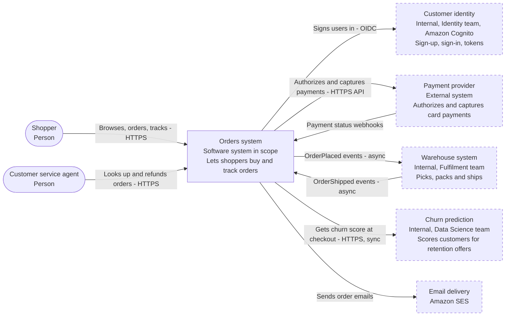
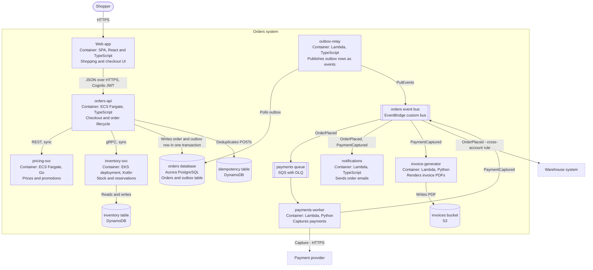
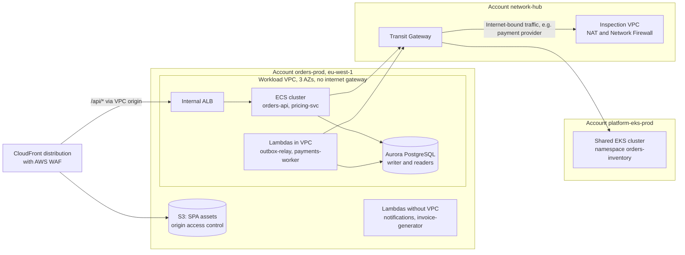
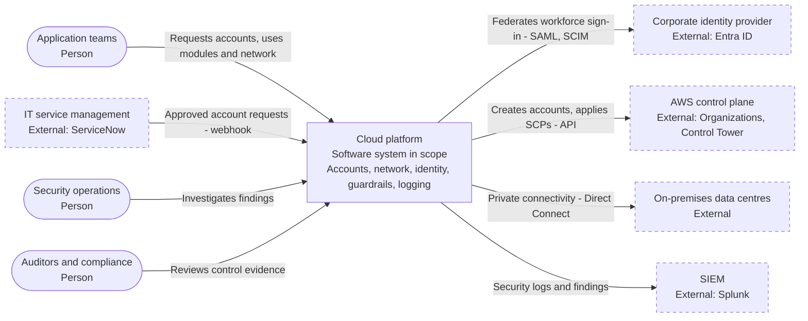
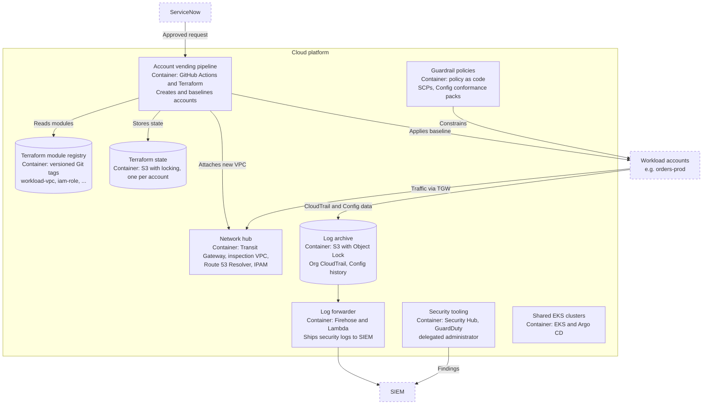
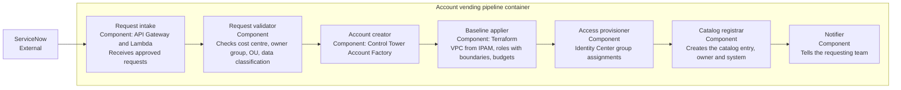
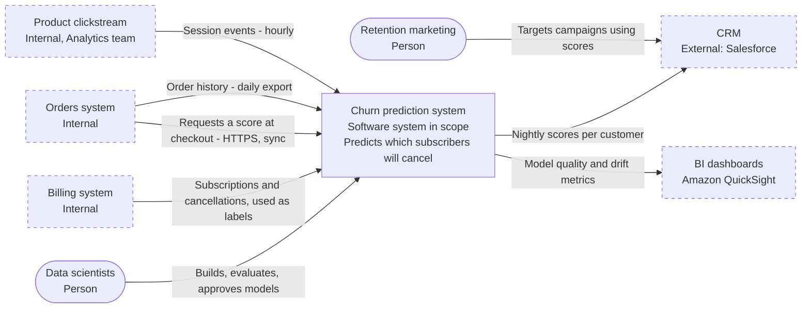
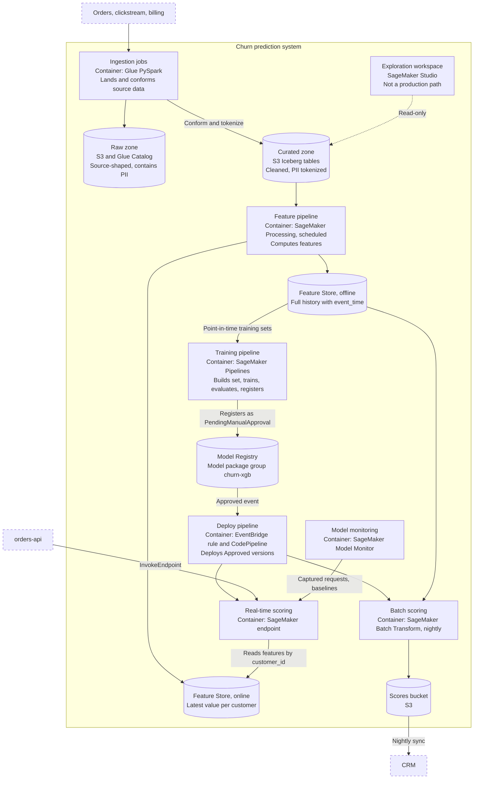
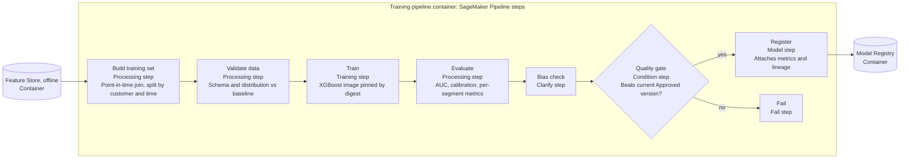

[Overview](../README.md) › [Concepts explained](README.md)

# C4 diagrams: L1, L2 and L3 for all three systems

## 4.1 Definitions

For when to use each level, see [Level of detail](../topics/level-of-detail.md). The C4 model, created by Simon Brown, describes a software system with a small set of abstractions and then draws them at increasing levels of zoom.

| Abstraction | Meaning | AWS-flavoured examples |
|---|---|---|
| **Person** | A human user or role | Shopper, data scientist, auditor |
| **Software system** | Something that delivers value and is owned by one team. Either the system in scope, or one it interacts with (another internal team's system counts as external) | Orders, the Warehouse system, the Cognito pool owned by Identity |
| **Container** | A separately runnable or deployable unit that executes code or stores data. **Not a Docker container.** | ECS service, EKS deployment, Lambda function, SPA in the browser, Aurora cluster, DynamoDB table, S3 bucket used as a data store |
| **Component** | A group of related code behind an interface, inside one container | A module, package or set of handlers |
| **Code** | Classes and functions | — |

| Level | Question it answers | Audience | Scope | Where it lives |
|---|---|---|---|---|
| **L1 System context** | What is this, who uses it, what does it depend on? | Everyone, including non-technical readers, security and auditors | One system | System doc; each repo shows a cropped copy |
| **L2 Container** | What are the runnable pieces and data stores, in what technology, and how do they talk? | Engineers, architects, operations, security | One system | System doc; each repo shows its own container and its neighbours |
| **L3 Component** | How is one container structured inside? | Engineers working on that container | One container | That container's repo, and only if the structure isn't obvious |
| **L4 Code** | Classes and functions | — | One component | Don't draw it by hand; your IDE already does |

C4 also defines supporting diagrams:

- **System landscape:** many systems at once.
- **Deployment:** maps containers onto infrastructure such as accounts, regions, VPCs and clusters.
- **Dynamic:** the sequence of steps in one specific flow.

**Rules of thumb for mapping AWS onto C4** *(recommendation)*

- **Plumbing belongs in the deployment diagram, not L2.** This covers load balancers, CloudFront, NAT gateways, VPCs, subnets and security groups. The exception is an API Gateway that carries real logic you own and clients depend on, such as authorizers or request validation; that can appear at L2.
- **Lambda.** Draw one container per function that has its own responsibility and its own IAM role. Collapse trivial glue functions.
- **Queues and buses.** Draw them as containers when they carry design meaning, such as fan-out, buffering or a dead-letter queue (DLQ). Otherwise just label the arrow "via SQS".
- **Managed services owned by another team.** For example, a Cognito pool run by Identity is an *external system* at L1, not one of your containers.
- **Every arrow says what flows and how.** Write "Publishes OrderPlaced (EventBridge, async)", never "uses".

The diagrams below are Mermaid flowcharts, which GitHub, GitLab and most developer portals render natively. Mermaid also has an experimental C4-specific syntax. Structurizr DSL is the better choice when several diagrams must stay consistent ([§4.5](#45-keeping-the-levels-consistent-one-model-many-views)).

**Legend for every diagram:**

- rounded box = person
- rectangle = system, container or component
- cylinder = data store
- double-bordered box = queue or event bus
- dashed border = outside the scope being drawn

## 4.2 Orders

### L1: System context



**What L1 includes:** people, the one system in scope, and every system it talks to, with what flows and in which direction.

**What L1 leaves out:** ECS, Lambda, databases, accounts and regions. Those are L2 and deployment concerns. A non-technical stakeholder or an auditor should be able to read this diagram unaided.

**Judgment call.** Cognito is drawn as an external system because the Identity team owns it. If the Orders team owned its own user pool, the pool would be a container at L2 instead.

### L2: Containers



**What L2 includes:** every runnable unit and data store, its technology, and every interaction labelled with protocol and sync or async.

**What L2 leaves out, and why:**

- *CloudFront, the ALB, VPCs and NAT* go in the deployment diagram below.
- *Task counts, memory sizes and instance classes* are configuration that lives in IaC.
- *IAM role names* are volatile and also a security detail.
- *Classes and modules* belong at L3.

**Where it lives.** This full diagram lives in the Orders system doc. Each service repo shows only its own container plus its direct neighbours, ideally generated from the same model ([§4.5](#45-keeping-the-levels-consistent-one-model-many-views)).

### L3: Components inside `orders-api`

```mermaid
flowchart TB
  spa["Web app<br/>Container"]
  subgraph apibox["orders-api container"]
    http["HTTP layer<br/>Component: Fastify routes<br/>Validates requests against OpenAPI"]
    auth["Auth middleware<br/>Component<br/>Verifies Cognito JWTs, maps scopes"]
    idem["Idempotency guard<br/>Component<br/>Deduplicates by Idempotency-Key header"]
    checkout["Checkout service<br/>Component: domain logic<br/>Order state machine, no I/O"]
    pricingc["Pricing client<br/>Component<br/>REST client with timeout and fallback"]
    invc["Inventory client<br/>Component<br/>gRPC client for reservations"]
    repo["Order repository<br/>Component<br/>Writes order and outbox rows atomically"]
  end
  pricing["pricing-svc<br/>Container"]
  inv["inventory-svc<br/>Container"]
  ordersdb[("orders database<br/>Container")]
  idemdb[("idempotency table<br/>Container")]

  spa --> http
  http --> auth
  http --> idem
  idem --> idemdb
  http --> checkout
  checkout --> pricingc
  pricingc --> pricing
  checkout --> invc
  invc --> inv
  checkout --> repo
  repo --> ordersdb
```



**Why this L3 earns its place.** It makes two invariants visible: the domain component has no outbound I/O, and only the repository touches the database. A newcomer can see where a new rule goes (Checkout service) and where a new downstream call goes (a new client component).

**When to skip L3.** For `notifications`, a single Lambda handler with an email template, an L3 diagram would add nothing.

### Supplementary: deployment view

AWS readers usually want to know where CloudFront, the ALB and the accounts fit. That belongs here, not at L2.



The deployment view shows *shape*, not numbers: which account, which network path, which cluster. It also ties the Orders design to the platform's invariants: there is no internet gateway, so egress goes through the inspection VPC.

## 4.3 Cloud platform

C4 was designed for software systems. A platform *is* a software system whose product happens to be infrastructure. It fits naturally at L1, and fits at L2 if you treat each platform service (vending pipeline, network hub, log pipeline) as a container. Below L2, the most-used views are usually the account tree and the network topology, which are deployment-level views. Use them instead of forcing everything into C4.

### L1: System context



**Judgment call.** "AWS" usually isn't drawn in an application's context diagram. For a landing zone it belongs there, because the platform's main job is to drive AWS control-plane APIs.

### L2: Containers (the platform's own services)



### L3: Components inside the account vending pipeline



**Why this L3 is worth drawing.** Every account in the company passes through it. The validator and baseline applier are where most of the platform's invariants are enforced, so the diagram tells a reviewer where to look.

### Supplementary: the account tree (often the most-used platform view)

```text
Root
├── Security OU          log-archive, security-tooling
├── Infrastructure OU    network-hub, shared-services, platform-eks-prod, platform-eks-nonprod
├── Workloads OU
│   ├── Prod OU          orders-prod, data-lake-prod, ml-prod, ...
│   └── NonProd OU       orders-staging, ml-dev, ...
├── Sandbox OU           per-engineer sandboxes; no Transit Gateway attachment
└── Suspended OU         closed accounts awaiting deletion
```

Show which SCPs attach to which OU in the doc (by name and purpose, not as pasted JSON).

## 4.4 Churn prediction

### L1: System context



**Judgment call.** Orders appears twice in different roles, as a data source and as a real-time consumer. Draw both relationships, because they have different owners, latencies and failure modes.

### L2: Containers



**What this L2 makes visible:**

- The production path, from sources through registry to endpoint and batch.
- The single source of features feeding both stores (the skew invariant).
- The approval gate.
- That Studio is read-only and off the production path (an absence, drawn with a dotted line).

### L3: Components inside the training pipeline



**Note on pipelines.** For a pipeline, the component view and the dynamic (sequence) view are nearly the same picture, because the components *are* ordered steps. That's fine; don't draw both.

## 4.5 Keeping the levels consistent: one model, many views

Hand-drawn diagrams drift apart: L1 says one thing, L2 another, each repo a third. Structurizr DSL solves this by defining each element once and generating every view from that one model. A minimal Orders example:

```text
workspace "Orders" {
  model {
    shopper = person "Shopper"
    psp = softwareSystem "Payment provider" {
      tags "External"
    }
    orders = softwareSystem "Orders system" {
      spa = container "Web app" "Shopping and checkout UI" "React, TypeScript"
      api = container "orders-api" "Checkout and order lifecycle" "TypeScript, ECS Fargate"
      db  = container "orders database" "Orders and outbox" "Aurora PostgreSQL" {
        tags "Database"
      }
      pay = container "payments-worker" "Captures payments" "Python, Lambda"
    }
    shopper -> spa "Browses and buys" "HTTPS"
    spa -> api "Calls" "JSON over HTTPS"
    api -> db "Writes order and outbox row" "SQL"
    pay -> psp "Captures payments" "HTTPS"
  }
  views {
    systemContext orders "L1-context" {
      include *
      autolayout lr
    }
    container orders "L2-containers" {
      include *
      autolayout tb
    }
  }
}
```

Rename a container here and every view updates. In a multi-repo estate, each team's workspace can extend a shared catalog of systems and people (the shared system-catalog pattern in [Multi-repo topology](../topics/multi-repo.md#preventing-duplication-and-contradiction)). Mermaid is simpler for single-repo diagrams; Structurizr wins once you have more than a handful of related diagrams.

**Read more**

- C4 model home: <https://c4model.com/>
- C4 abstractions: <https://c4model.com/abstractions>
- System context diagram: <https://c4model.com/diagrams/system-context>
- Container diagram: <https://c4model.com/diagrams/container>
- Component diagram: <https://c4model.com/diagrams/component>
- Deployment diagram: <https://c4model.com/diagrams/deployment>
- Dynamic diagram: <https://c4model.com/diagrams/dynamic>
- System landscape diagram: <https://c4model.com/diagrams/system-landscape>
- Diagram review checklist: <https://c4model.com/diagrams/checklist>
- Full worked example, "Internet Banking System": <https://c4model.com/example>
- Structurizr DSL: <https://docs.structurizr.com/dsl>
- Mermaid flowcharts: <https://mermaid.js.org/syntax/flowchart.html>
- Mermaid's experimental C4 syntax: <https://mermaid.js.org/syntax/c4.html>

---

[Concepts explained](README.md): [Absences](absences.md) · [Invariants](invariants.md) · **C4 diagrams** · [Conventions](non-default-conventions.md) · [Wiki links](wiki-links.md) · [Anti-content](anti-content.md) · [ARCHITECTURE.md excerpts](architecture-md-excerpts.md)
