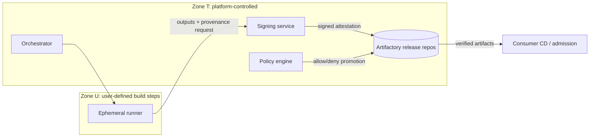

[Overview](../README.md) › [Worked examples](README.md)

# Example 1 — CI/CD platform (orchestration + Artifactory + security tooling)

**Framing.** The platform is a product for internal teams, so separate the *consumer contract* from *internals*. Use supply-chain standards as the trust vocabulary:

- **SLSA Build levels.** L1: "Provenance showing how the package was built". L2: "Signed provenance, generated by a hosted build platform". L3: "Hardened build platform", which must "prevent runs from influencing one another" and keep signing secrets out of user-defined steps.
- **Sigstore keyless signing** "associates identities, rather than keys, with an artifact signature" using short-lived Fulcio certificates and the Rekor transparency log.
- **SBOM minimum elements.** NTIA's 2021 list has seven fields: "Supplier, Component Name, Version of the Component, Other Unique Identifiers, Dependency Relationship, Author of SBOM Data, and Timestamp". CISA's July 29, 2026 press release for the "2026 Minimum Elements for a Software Bill of Materials (SBOM)" says "There are several new minimum elements, such as Component Hash Algorithm, Component License, SBOM Tool Name, and SBOM Generation Context." The update also renames Supplier Name to Component Producer, Version of the Component to Component Version, and Author of SBOM Data to SBOM Author.

**(a) GOOD doc set**

```
platform-cicd/
  ARCHITECTURE.md            # internals, ~400 lines
  docs/consumer-guide.md     # the product contract
  docs/policy-gates.md       # GENERATED from policy-as-code repo
  docs/adr/0007-keyless-signing-sigstore.md
  docs/adr/0011-artifactory-as-sole-promotion-path.md
  AGENTS.md                  # ~80 lines, router
```

````markdown
# CI/CD Platform — Architecture
owner: team:platform-delivery · last_reviewed: 2026-09-14 · review_interval: 90d

## Purpose
Build, verify, sign and promote artifacts for product teams. Target: SLSA Build L3
for tier-1 services, L2 otherwise (ADR-0004). Gap to target is tracked under Known gaps.

## Pipeline stages and enforcement points
| Stage | Runs where | Enforcement point (blocking?) | Evidence emitted |
|---|---|---|---|
| Source | SCM | Branch protection, signed commits (blocking, tier-1) | SCM audit log |
| Build | Ephemeral isolated runners | Deps only via Artifactory remotes (blocking) | SLSA provenance |
| Scan | Same run | SAST, SCA, secrets; thresholds live in policy repo | Reports attached to build |
| Sign | Signing service (separate trust zone) | Keyless; runner never holds keys | Signature + Rekor entry |
| SBOM | Same run | Required for promotion (blocking) | SPDX/CycloneDX in Artifactory |
| Promote | Artifactory | Only if provenance+signature+SBOM verify (blocking) | Promotion record |
| Deploy | Consumer CD | Admission controller verifies signature (prod) | Admission log |

## Trust boundaries


## Architecture invariants
- **No artifact reaches a release repo without verified provenance, signature and SBOM.** Break-glass is ADR-0013 and audited.
- **User-defined build steps never see signing material.**
- **Runners have no direct internet egress;** all dependencies resolve through Artifactory.
- Policy thresholds live in `policy-as-code`; this doc never restates them.

## How consuming teams interact
See docs/consumer-guide.md: required template version, what blocks you, exception process,
SLOs (queue time p95, availability), support channel.
````

**(b) BAD**

```markdown
# CI/CD Architecture (Confluence, last edited 2023)
We use Jenkins with 42 agents (m5.2xlarge) and Artifactory 7.41 on 3 nodes.
Steps: 1) checkout 2) mvn clean install 3) run Fortify 4) run Snyk with
--severity-threshold=high 5) if fails, ping #security ... [300 lines of Jenkinsfile pasted]
Security is handled by the security team. See also: (link to 404).
```

**What's wrong:**

- Volatile facts: agent counts, versions, instance types.
- Pasted pipeline code that duplicates the template repo.
- Policy thresholds hard-coded in prose, which will contradict the policy engine.
- No trust boundaries or enforcement points.
- "Security is handled by…" dodges ownership.
- No consumer contract.
- An ownerless wiki page with no freshness date.

**(c) Judgment calls:**

- Split the consumer guide (many readers, stable) from internals (few readers).
- Generate the policy-gate table.
- Present enforcement points as a table, because that is what auditors and incident responders scan.
- State target SLSA levels per tier and record the gap as debt, not as a claim.

---

## Sources

- [SLSA v1.0: Security levels](../sources/supply-chain.md#slsa-v10-security-levels) (Software supply chain)
- [Sigstore documentation](../sources/supply-chain.md#sigstore-documentation) (Software supply chain)
- [NTIA: "The Minimum Elements for a Software Bill of Materials (SBOM)" (Jul 2021)](../sources/supply-chain.md#ntia-the-minimum-elements-for-a-software-bill-of-materials-sbom-jul-2021) (Software supply chain)
- [CISA et al.: "2026 Minimum Elements for a Software Bill of Materials (SBOM)" (Jul 29, 2026)](../sources/supply-chain.md#cisa-et-al-2026-minimum-elements-for-a-software-bill-of-materials-sbom-jul-29-2026) (Software supply chain)
