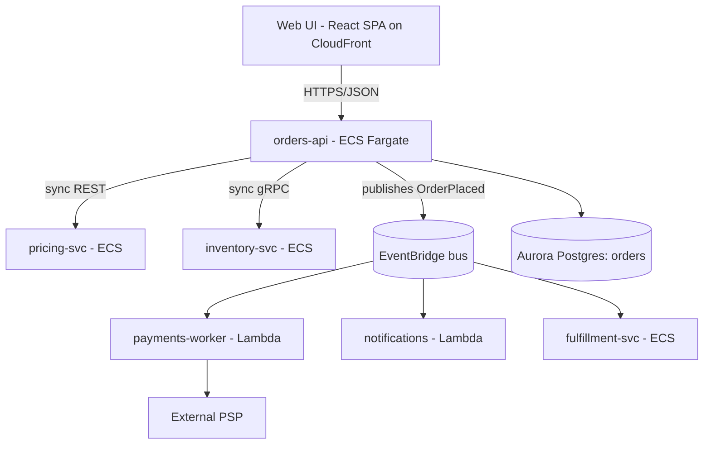

[Overview](../README.md) › [Worked examples](README.md)

# Example 2 — Web app: UI + primary backend + 5 services, shared libs, ECS + Lambda

# Orders System — System Architecture
owner: group:orders-arch · last_reviewed: 2026-08-30 · model: ./workspace.dsl

## Containers (C4 L2) — generated from model

## Communication rules
- Sync only on the request path for data needed to answer the user; everything after
  order acceptance is async via EventBridge.
- Events are at-least-once; consumers are idempotent on `orderId` + `eventId`.
- **No service reads another service's database** (enforced by IAM).

## Contract index
| Contract | Type | Producer | Consumers | Compatibility |
|---|---|---|---|---|
| orders-api v2 | OpenAPI | orders-api | UI | additive only; v1 sunset ADR-0021 |
| OrderPlaced v3 | JSON Schema (registry) | orders-api | payments, notifications, fulfillment | backward-compatible; CI check |
| inventory.Reserve | protobuf | inventory-svc | orders-api | buf breaking check |

## Shared libraries
| Library | Owner | Scope | Versioning |
|---|---|---|---|
| @orders/auth-client | team:identity | token validation only | semver; N and N-1 |
| orders-events (TS + Python) | team:orders-core | generated event types; no logic | per schema version |
Rule: no domain logic in shared libs without an ADR.

## Runtime-specific constraints
| Concern | ECS services | Lambda functions |
|---|---|---|
| State | stateless tasks; sessions in Redis | stateless; no reliance on warm containers |
| Timeouts | ALB idle timeout governs | function timeout < queue visibility timeout |
| Concurrency | autoscaling (values in IaC) | reserved concurrency in IaC for PSP limits |
| Deploy | blue/green | aliases + weighted traffic |

## Key flows: F1 Place order · F2 Payment failure & compensation
## System ADRs: 0003 EventBridge fan-out · 0009 no shared DB · 0021 API v1 sunset

---
---
---
---
---

Each service repo (e.g., `payments-worker`) has a purpose statement, a generated neighbor-only L2 crop, a codemap, **invariants** ("Never calls PSP without idempotency key"; "Never writes to orders DB"), consumed contracts by ID, and local ADRs.

**(b) BAD:** a 60-page "Solution Architecture Document" in the primary backend repo. It describes all five services' classes, lists ECS task counts and Lambda memory sizes, copies the OpenAPI spec as a table, and has a hand-drawn diagram still showing payments as an ECS service. The shared library section says "use the commons lib" with no owner. The `fulfillment-svc` README contradicts it about sync vs async.

**What's wrong:**

- System facts live in one service's repo.
- It duplicates specs and IaC.
- It describes other teams' internals, which guarantees drift.
- There are no delivery semantics.
- Shared code has no owner.
- The diagram is not model-generated, so the runtime change never propagated.

**(c) Judgment calls:**

- Write sync vs async as a *rule*, not a description.
- Use one runtime-comparison table and keep the numbers in IaC.
- The shared-library scope limit is the most valuable sentence in the doc.
- Per-service docs show neighbors only.

The same Orders system is worked through in more depth in [Concepts explained](../concepts/README.md#orders-ui-api-backend): its [absences](../concepts/absences.md#examples-orders-ui-api-backend), [invariants](../concepts/invariants.md#examples-orders), [C4 L1–L3 diagrams](../concepts/c4-diagrams.md#42-orders) and [conventions](../concepts/non-default-conventions.md#examples-orders-ui-api-backend).
